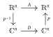

> Relations are the fundamental fabric of reality.
>
> Michele Coscia

(s-prelob)=
## Motivation
Alongside the exponential growth of computer networks over the last few decades, we have witnessed concurrent and equally rapid growth in a field called *network science*. Once computer networks brought network structure into clearer focus, scientists began to recognize networks almost everywhere, even in phenomena that had already received centuries of attention using other methods, and to apply network theory to organize and expand knowledge right throughout the sciences, in every field and discipline.

The set of possible examples is vast, and sources mentioning or treating hundreds of different applications of network methods and graph theory are listed in the reading notes at the end of the chapter. In computer science and machine learning alone, we see computational graphs, graphical networks, neural networks and deep learning. In operations research, network analysis focuses on minimum cost flow, traveling salesman, shortest path, and assignment problems. In biology, networks are a standard way to represent interactions between bioentities.

In this book, our interest lies in economic and social phenomena. Here, too, networks are pervasive. Important examples include financial networks, production networks, trade networks, transport networks and social networks. For example, social and information networks affect trends in sentiments and opinions, consumer decisions, and a range of peer effects. The topology of financial networks helps to determine relative fragility of the financial system, while the structure of production networks affects trade, innovation and the propagation of local shocks.

{numref}`f-crude_oil_2021`–{numref}`f-commercial_aircraft_2019_1` show two examples of trade networks. {numref}`f-crude_oil_2021` is called a *Sankey diagram*, which is a kind of figure used to represent flows. Oil flows from left to right. The countries on the left and below are the top 10 exporters of crude oil, while the countries on the right are the top 20 consumers. The figure relates to one of our core topics: optimal (and equilibrium) flows across networks. We treat optimal flows at length in {prf:ref}`c-ofd`.[^1]

{numref}`f-commercial_aircraft_2019_1` shows international trade in large commercial aircraft in 2019.[^2] Node size is proportional to total exports and link width is proportional to exports to the target country. The US, France and Germany are revealed as major export hubs.

```{figure} figures/crude_oil_2021.svg
:name: f-crude_oil_2021

International trade in crude oil 2021
```

```{figure} figures/commercial_aircraft_2019_1.svg
:name: f-commercial_aircraft_2019_1

International trade in commercial aircraft during 2019
```

While some readers viewing {numref}`f-crude_oil_2021`–{numref}`f-commercial_aircraft_2019_1` might at first suspect that the network perspective adds little more than an attractive technique for visualizing data, it actually adds much more. For example, in {numref}`f-commercial_aircraft_2019_1`, node colors are based on a ranking of "importance" in the network called *eigenvector centrality*, which we introduce in {ref}`sss-eigcen`. Such rankings and centrality measures are an active area of research among network scientists. Eigenvector and other forms of centrality feature throughout the text. For example, we will see that these concepts are closely connected to—and shed new light on—fundamental ideas first developed many years ago by researchers in the field of input-output economics.

In addition, in production networks, it turns out that the nature of shock propagation is heavily dependent on the underlying structure of the network. For example, for a few highly connected nodes, shocks occurring within one firm or sector can have an outsized influence on aggregate-level fluctuations. Economists are currently racing to understand these relationships, their interactions with various centrality measures, and other closely related phenomena.

To understand this line of work, as well as other applications of network methods to economics and finance, some technical foundations are required. For example, to define eigenvector centrality, we need to be familiar with eigenvectors, spectral decompositions and the Perron–Frobenius theorem. To work with *Katz centrality*, which also features regularly in network science and economics, we require a sound understanding of the Neumann series lemma. The Perron–Frobenius theorem and the Neumann series lemma form much of the technical foundation of this textbook. We review them in detail in {ref}`s-introcs` and develop extensions throughout remaining chapters.

One reason that analysis of networks is challenging is high-dimensionality. To see why, consider implementing a model with $n$ economic agents. This requires $n$ times more data than one representative agent in a setting where agents are atomistic or coordinated by a fixed number of prices. For example, {cite}`carvalho2019large` model the dynamics of $n = 6 \times 10^6$ firms, all of which need to be tracked when running a simulation. However, if we wish to model interactions between each pair $i, j$ (supply linkages, liabilities, etc.), then, absent sparsity conditions, the data processing requirement grows like $O(n^2)$.[^3] In the {cite}`carvalho2019large` example, $n^2$ is $3.6 \times 10^{13}$, which is very large even for modern computers. One lesson is that network models can be hard to solve, even with powerful computers, unless we think carefully about algorithms.

In general, to obtain a good grasp on the workings of economic networks, we will need computational skills plus a firm understanding of linear algebra, probability and a field of discrete mathematics called graph theory. The rest of this chapter provides relevant background in these topics. Before tackling this background, we recommend that readers skim the list of common symbols, as well the mathematical topics in the appendix, which start. (The appendix is not intended for sequential reading, but rather as a source of definitions and fundamental results to be drawn on in what follows.)

(s-introcs)=
## Spectral Theory
In this section we review some linear algebra needed for the study of graphs and networks. Highlights include the spectral decomposition of diagonalizable matrices, the Neumann series lemma, and the theorem of Perron and Frobenius.

(ss-eigen)=
### Eigendecompositions
Our first task is to cover spectral decompositions and the spectral theorem. We begin with a brief review of eigenvalues and their properties. (If you are not familiar with eigenvalues and eigenvectors, please consult an elementary treatment first. See, for example, {cite}`cohen2021linear`.)

#### Eigenvalues

Fix $A$ in $\matset{n}{n}$. A scalar $\lambda \in \CC$ is called an **eigenvalue** of $A$ if there exists a nonzero complex vector $e \in \CC^n$ such that $Ae = \lambda e$. A vector $e$ satisfying this equality is called an **eigenvector** corresponding to the eigenvalue $\lambda$. (Notice that eigenvalues and eigenvectors are allowed to be complex, even though we restrict elements of $A$ to be real.) The set of all eigenvalues of $A$ is called the **spectrum** of $A$ and written as $\sigma(A)$. As we show below, $A$ has at most $n$ distinct eigenvalues.

In Julia, we can check for the eigenvalues of a given square matrix $A$ via `eigvals(A)`. Here is one example

``` julia
using LinearAlgebra
A = [0 -1;
     1  0]
eigenvals = eigvals(A) 
```

Running this code in a Jupyter cell (with Julia kernel) or Julia REPL produces

``` julia
2-element Vector{ComplexF64}:
 0.0 - 1.0im
 0.0 + 1.0im
```

Here `im` stands for $i$, the imaginary unit (i.e., $i^2=-1$).

````{exercise}
:label: ex-intro-auto-1

Using pencil and paper, confirm that Julia's output is correct. In particular, show that

```{math}
:enumerated: false

A = 
        \begin{pmatrix}
            0 & -1 \\
            1 & 0
        \end{pmatrix}
        \quad \implies \quad
        \sigma(A) = \{i, -i\},
```

with corresponding eigenvectors $(-1, i)^\top$ and $(-1, -i)^\top$.
````


````{solution} ex-intro-auto-1

For $\lambda_1= i$, we have

```{math}
:enumerated: false

A e_1 = 
        \begin{pmatrix}
            0 & -1 \\
            1 & 0
        \end{pmatrix} 
        \begin{pmatrix}
            -1 \\
            i
        \end{pmatrix} =
        \begin{pmatrix}
            -i \\
            -1
        \end{pmatrix} = \lambda_1 e_1.
```

Similarly for $\lambda_2= -i$, we have

```{math}
:enumerated: false

A e_2 = 
        \begin{pmatrix}
            0 & -1 \\
            1 & 0
        \end{pmatrix} 
        \begin{pmatrix}
            -1 \\
            -i
        \end{pmatrix} =
        \begin{pmatrix}
            i \\
            -1
        \end{pmatrix} = \lambda_2 e_2.
```
````


If $\lambda \in \sigma(A)$ and $e$ is an eigenvector for $\lambda$, then $(\lambda, e)$ is called an **eigenpair**.

```{exercise}
:label: ex-uniev

Prove: if $(\lambda, e)$ is an eigenpair of $A$ and $\alpha$ is a nonzero scalar, then $(\lambda, \alpha e)$ is also an eigenpair of $A$.
```


````{solution} ex-uniev

Fix an eigenpair $(\lambda, e)$ of $A$ and a nonzero scalar $\alpha$. We have

```{math}
:enumerated: false

A (\alpha e) = \alpha A e
                     = \lambda (\alpha e).
```

Hence $\alpha e$ is an eigenvector and $\lambda$ is an eigenvalue, as claimed.
````


```{prf:lemma}
:label: l-chlam

$\lambda \in \CC$ is an eigenvalue of $A$ if and only if $\det(A - \lambda I) = 0$.
```


```{prf:proof}
:nonumber:

If $\lambda \in \RR$, then {prf:ref}`l-chlam` follows directly from {prf:ref}`t-nncase`, since $\det(A - \lambda I) = 0$ is equivalent to existence of nonzero vector $e$ such that $(A - \lambda I) e = 0$, which in turn says that $\lambda$ is an eigenvalue of $A$. The same arguments extend to the case $\lambda \in \CC$ because the statements in {prf:ref}`t-nncase` are also valid for complex-valued matrices (see, e.g., {cite}`jan`). ◻
```


It can be shown that $p(\lambda) := \det(A -\lambda I)$ is a polynomial of degree $n$.[^4] This polynomial is called the **characteristic polynomial** of $A$. By the Fundamental Theorem of Algebra, there are $n$ roots (i.e., solutions in $\CC$ to the equation $p(\lambda)=0$), although some may be repeated as in the complete factorization of $p(\lambda)$. By {prf:ref}`l-chlam`,

(i) each of these roots is an eigenvalue, and

(ii) no other eigenvalues exist besides these $n$ roots.

If $\lambda \in \sigma(A)$ appears $k$ times in the factorization of the polynomial $p(\lambda)$, then $\lambda$ is said to have **algebraic multiplicity** $k$. An eigenvalue with algebraic multiplicity one is called **simple**. A simple eigenvalue $\lambda$ has the property that its eigenvector is unique up to a scalar multiple, in the sense of {prf:ref}`ex-uniev`. In other words, the linear span of $\setntn{e \in \CC^n}{(\lambda, e) \text{ is an eigenpair}}$ (called the **eigenspace** of $\lambda$) is one-dimensional.

```{exercise}
:label: ex-tausigma

For $A \in \matset{n}{n}$, show that $\lambda \in \sigma(A)$ iff $\tau \lambda \in \sigma(\tau A)$ for all $\tau > 0$.
```


```{solution} ex-tausigma

Fix $A \in \matset{n}{n}$ and $\tau > 0$. If $\lambda \in \sigma(A)$, then $\tau^n \det(A - \lambda I) = 0$, or $\det(\tau A - \tau \lambda I) = 0$. Hence $\tau \lambda \in \sigma(\tau A)$. To obtain the converse implication, multiply by $1/\tau$.
```


```{exercise}
:label: ex-dirip

A useful fact concerning eigenvectors is that if the characteristic polynomial $p(\lambda) := \det(A - \lambda I)$ has $n$ distinct roots, then the $n$ corresponding eigenvectors form a basis of $\CC^n$. Prove this for the case where all eigenvectors are real—that is show that the $n$ (real) eigenvectors form a basis of $\RR^n$. (Bases are defined in {ref}`sss-bvd`. Proving this for $n=2$ is also a good effort.)
```


````{solution} ex-dirip

If $p(\lambda) := \det(A - \lambda I)$ has $n$ distinct roots, then $|\sigma(A)|=n$. For each $\lambda_i \in \sigma(A)$, let $e_i$ be a corresponding eigenvector. It suffices to show that $\{e_i\}_{i=1}^n$ is linearly independent. To this end, let $k$ be the largest number such that $\{e_1, \ldots, e_k\}$ is independent. Seeking a contradiction, suppose that $k < n$. Then $e_{k+1} = \sum_{i=1}^k \alpha_i e_i$ for suitable scalars $\{\alpha_i\}$. Hence, by $A e_{k+1} = \lambda_{k+1} e_{k+1}$, we have

```{math}
:enumerated: false

\sum_{i=1}^k \alpha_i \lambda_i e_i
        = \sum_{i=1}^k \alpha_i \lambda_{k+1} e_i
        \quad \iff \quad
        \sum_{i=1}^k \alpha_i (\lambda_i - \lambda_{k+1}) e_i = 0.
```

Since $\{e_1, \ldots, e_k\}$ is independent, we have $\alpha_i (\lambda_i - \lambda_{k+1})  = 0$ for all $i$. At least one $\alpha_i$ is nonzero, so $\lambda_i = \lambda_{k+1}$ for some $i \leq k$. Contradiction.
````


(sss-eigde)=
#### The Eigendecomposition
What are the easiest matrices to work with? An obvious answer to this question is: the diagonal matrices. For example, when $D = \diag(\lambda_i)$ with $i \in \natset{n}$,

- the linear system $Dx = b$ reduces to $n$ completely independent scalar equations,

- the $t$-th power $D^t$ is just $\diag(\lambda_i^t)$, and

- the inverse $D^{-1}$ is just $\diag(\lambda_i^{-1})$, assuming all $\lambda_i$'s are nonzero.

While most matrices are not diagonal, there is a way that "almost any" matrix can be viewed as a diagonal matrix, after translation of the usual coordinates in $\RR^n$ via an alternative basis. This can be extremely useful. The key ideas are described below.

$A \in \matset{n}{n}$ is called **diagonalizable** if

```{math}
:enumerated: false

A = P D P^{-1}
    \text{ for some } 
    D = \diag(\lambda_1, \ldots, \lambda_n)
    \text{ and nonsingular matrix } P.
```

We allow both $D$ and $P$ to contain complex values. The representation $P D P^{-1}$ is called the **eigendecomposition** or the **spectral decomposition** of $A$.

One way to think about diagonalization is in terms of maps, as in



Either we can map directly with $A$ or, alternatively, we can shift to $\CC^n$ via $P^{-1}$, apply the diagonal matrix $D$, and then shift back to $\RR^n$ via $P$.

The equality $A = P D P^{-1}$ can also be written as $A P =  P D$. Decomposed across column vectors, this equation says that each column of $P$ is an eigenvector of $A$ and each element along the principal diagonal of $D$ is an eigenvalue.

```{exercise}
:label: ex-intro-auto-2

Confirm this. Why are column vectors taken from $P$ nonzero, as required by the definition of eigenvalues?
```


```{solution} ex-intro-auto-2

Suppose to the contrary that there is one zero column vector in $P$. Then $P$ is not nonsingular. Contradiction.
```


```{exercise}
:label: ex-intro-auto-3

The trace of a matrix is equal to the sum of its eigenvalues, and the determinant is their product. Prove this fact in the case where $A$ is diagonalizable.
```


````{solution} ex-intro-auto-3

Let $A$ be as stated, with $A = P D P^{-1}$. Using elementary properties of the trace and determinant, we have

```{math}
:enumerated: false

\trace(A) 
        = \trace(P D P^{-1}) 
        = \trace(D P P^{-1}) 
        = \trace(D) 
        = \sum_i \lambda_i
```

and

```{math}
:enumerated: false

\det(A) 
        = \det(P)\det(D) \det(P^{-1}) 
        = \det(P)\det(D) \det(P)^{-1} 
        = \det(D) 
        = \prod_i \lambda_i.
```
````


```{exercise}
:label: ex-intro-auto-4

The asymptotic properties of the map $m \mapsto A^m$ are determined by the eigenvalues of $A$. This is clearest in the diagonalizable case, where $A = P \diag(\lambda_i) P^{-1}$. To illustrate, use induction to show that

$$
A = P \diag(\lambda_i) P^{-1} 
        \; \implies \;
        A^m = P \diag (\lambda_i^m) P^{-1}
        \text{ for all } m \in \NN.
$$ (eq-diagpow)
```


When does diagonalizability hold?

While diagonalizability is not universal, the set of matrices in $\matset{n}{n}$ that fail to be diagonalizable has "Lebesgue measure zero" in $\matset{n}{n}$. (Loosely speaking, only special or carefully constructed examples will fail to be diagonalizable.) The next results provide conditions for the property.

```{prf:theorem}
:label: t-diagiff

A matrix $A \in \matset{n}{n}$ is diagonalizable if and only if its eigenvectors form a basis of $\CC^n$.
```


This result is intuitive: for $A = P D P^{-1}$ to hold we need $P$ to be invertible, which requires that its $n$ columns are linearly independent. Since $\CC^n$ is $n$-dimensional, this means that the columns form a basis of $\CC^n$.

```{prf:corollary}
:label: c-dimdi

If $A \in \matset{n}{n}$ has $n$ distinct eigenvalues, then $A$ is diagonalizable.
```


```{prf:proof}
:nonumber:

See {prf:ref}`ex-dirip`. ◻
```


```{exercise}
:label: ex-intro-auto-5

Give a counterexample to the statement that the condition in {prf:ref}`c-dimdi` is necessary as well as sufficient.
```


```{solution} ex-intro-auto-5

If $I$ is the identity and $Ie = \lambda e$ for some nonzero $e$, then $e = \lambda e$ and hence $\lambda=1$. Hence $\sigma(A) = \{1\}$. At the same time, $I$ is diagonalizable, since $I = I D I^{-1}$ when $D=I$.
```


There is another way that we can establish diagonalizability, based on symmetry. Symmetry also lends the diagonalization certain properties that turn out to be very useful in applications. We are referring to the following celebrated theorem.

````{prf:theorem} Spectral theorem
:label: t-spec

If $A \in \matset{n}{n}$ is symmetric, then there exists a real orthonormal $n \times n$ matrix $U$ such that

```{math}
:enumerated: false

A = U D U^\top
        \quad \text{with} \quad
        \lambda_i \in \RR_+ \text{ for all } i,
        \text{ where } 
        D = \diag(\lambda_1, \ldots, \lambda_n) .
```
````


Since, for the orthonormal matrix $U$, we have $U^\top = U^{-1}$ (see {prf:ref}`l-porthms`), one consequence of the spectral theorem is that $A$ is diagonalizable. For obvious reasons, we often say that $A$ is **orthogonally diagonalizable**.

(sss-wdi)=
#### Worker Dynamics
Let's study a small application of the eigendecomposition. Suppose that, each month, workers are hired at rate $\alpha$ and fired at rate $\beta$. Their two states are unemployment (state 1) and employment (state 2). {numref}`f-worker_switching` shows the transition probabilities for a given worker in each of these two states.

```{figure} figures/tikz_worker_switching.svg
:name: f-worker_switching

Worker transition dynamics
```

We translate these dynamics into the matrix

$$
P_w = 
    \begin{pmatrix}
        1-\alpha & \alpha \\
        \beta & 1- \beta
    \end{pmatrix}
    \quad \text{where} \quad
    0 \leq \alpha, \beta \leq 1.
$$ (eq-pww)

- Row 1 of $P_w$ gives probabilities for unemployment and employment respectively when currently unemployed.

- Row 2 of $P_w$ gives probabilities for unemployment and employment respectively when currently employed.

````{exercise}
:label: ex-intro-auto-6

Using {prf:ref}`l-chlam`, show that the two eigenvalues of $P_w$ are $\lambda_1 := 1$ and $\lambda_2 := 1-\alpha-\beta$. Show that, when $\min\{\alpha, \beta\} > 0$,

```{math}
:enumerated: false

e_1 := 
        \begin{pmatrix}
            1 \\
            1
        \end{pmatrix}
        \quad \text{and} \quad 
        e_2 :=
        \begin{pmatrix}
            -\alpha \\
            \beta
        \end{pmatrix}
```

are two corresponding eigenvectors, and that $\lambda_1$ and $\lambda_2$ are simple.
````


```{exercise}
:label: ex-intro-auto-7

Show that, when $\alpha=\beta=0$, the eigenvalue $\lambda_1$ is not simple.
```


Below we demonstrate that the $m$-th power of $P_w$ provides $m$-step transition probabilities for workers. Anticipating this discussion, we now seek an expression for $P^m_w$ at arbitrary $m \in \NN$. This problem is simplified if we use diagonalization.

````{exercise}
:label: ex-intro-auto-8

Assume that $\min\{\alpha, \beta\} > 0$. (When $\alpha=\beta=0$, computing the powers of $P_w$ is trivial.) Show that

```{math}
:enumerated: false

P_w = E D E^{-1}
        \quad \text{when} \quad 
        D = 
        \begin{pmatrix}
            1 & 0 \\
            0 & \lambda_2
        \end{pmatrix}
        \quad \text{and} \quad 
        E = 
        \begin{pmatrix}
            1 & -\alpha  \\
            1 & \beta
        \end{pmatrix}.
```

Using {eq}`eq-diagpow`, prove that

$$
P_w^m =
        \frac{1}{\alpha + \beta}
        \begin{pmatrix}
            \beta + \alpha(1-\alpha-\beta)^m & 
                \alpha(1 - (1-\alpha-\beta)^m) \\
            \beta(1-(1-\alpha-\beta)^m)  & 
                \alpha + \beta(1-\alpha-\beta)^m
        \end{pmatrix}
$$ (eq-pwpk)
for every $m \in \NN$.
````


(sss-lefteps)=
#### Left Eigenvectors
A vector $\epsilon \in \CC^n$ is called a **left eigenvector** of $A \in \matset{n}{n}$ if $\epsilon$ is an eigenvector of $A^\top$. In other words, $\epsilon$ is nonzero and there exists a $\lambda \in \CC$ such that $A^\top \epsilon = \lambda \epsilon$. We can alternatively write the expression as $\epsilon^\top A = \lambda \epsilon^\top$, which is where the name "left" eigenvector originates.

Left eigenvectors will play important roles in what follows, including that of stochastic steady states for dynamic models under a Markov assumption. To help distinguish between ordinary and left eigenvectors, we will at times call (ordinary) eigenvectors of $A$ **right eigenvectors** of $A$.

If $A$ is diagonalizable, then so is $A^\top$. To show this, let $A = P D P^{-1}$ with $D = \diag(\lambda_i)$. We know from earlier discussion that the columns of $P$ are the (right) eigenvectors of $A$.

```{exercise}
:label: ex-lei1

Let $Q = (P^\top)^{-1}$. Prove that $Q^\top P = I$ and $A^\top = Q D Q^{-1}$.
```


The results of the last exercise show that, when $A = P D P^{-1}$, the columns of $(P^\top)^{-1}$ coincide with the left eigenvectors of $A$. (Why?) Equivalently, $A = P D Q^\top$ where $Q = (\epsilon_1, \ldots, \epsilon_n)$ is the $n\times n$ matrix with $i$-th column equal to the $i$-th left eigenvector of $A$.

```{exercise}
:label: ex-lei2

Let $(e_i)_{i=1}^n$ be right eigenvectors of $A$ and let $(\epsilon_i)_{i=1}^n$ be the left eigenvectors. Prove that

$$
\inner{\epsilon_i, e_j} = \1\{i = j\}
        \qquad (i, j \in \natset{n}).
$$ (eq-lei2)
(Hint: Use the results of {prf:ref}`ex-lei1`.)
```


```{exercise}
:label: ex-aspecrep

Continuing with the notation defined above and continuing to assume that $A$ is diagonalizable, prove that

$$
A = \sum_{i=1}^n \lambda_i e_i \epsilon_i^\top
        \quad \text{and} \quad
        A^m = \sum_{i=1}^n \lambda_i^m e_i \epsilon_i^\top
$$ (eq-aspecrep)
for all $m \in \NN$. The expression for $A$ on the left hand side of {eq}`eq-aspecrep` is called the **spectral representation** of $A$.
```


```{exercise}
:label: ex-intro-auto-9

Prove that each $n \times n$ matrix $\lambda_i e_i \epsilon_i^\top$ in the sum $\sum_{i=1}^n \lambda_i e_i \epsilon_i^\top$ is rank 1.
```


(sss-sim)=
#### Similar Matrices
Diagonalizability is a special case of a more general concept: $A \in \matset{n}{n}$ is called **similar** to $B \in \matset{n}{n}$ if there exists an invertible matrix $P$ such that $A =  P B P^{-1}$. In this terminology, $A$ is diagonalizable if and only if it is similar to a diagonal matrix.

```{exercise}
:label: ex-intro-auto-10

Prove that similarity between matrices is an equivalence relation (see {ref}`sss-eqclass`) on $\matset{n}{n}$.
```


```{exercise}
:label: ex-intro-auto-11

The fact that similarity is an equivalence relation on $\matset{n}{n}$ implies that this relation partitions $\matset{n}{n}$ into disjoint equivalence classes, elements of which are all similar. Prove that all matrices in each equivalence class share the same eigenvalues.
```


````{exercise}
:label: ex-intro-auto-12

Prove: If $A$ is similar to $B$, then $A^m$ is similar to $B^m$. In particular

```{math}
:enumerated: false

A =  P B P^{-1} \; \implies \; A^m =  P B^m P^{-1}
        \text{ for all } m \in \NN.
```
````


The last result is a generalization of {eq}`eq-diagpow`. When $A$ is large, calculating the powers $A^k$ can be computationally expensive or infeasible. If, however, $A$ is similar to some simpler matrix $B$, then we can take powers of $B$ instead, and then transition back to $A$ using the similarity relation.[^5]

(ss-nsl)=
### The Neumann Series Lemma
Most high school students learn that, if $a$ is a number with $|a| < 1$, then

$$
\sum_{i \geq 0} a^i = \frac{1}{1-a}.
$$ (eq-sgeom)

This geometric series representation extends to matrices: If $A$ is a matrix satisfying a certain condition, then {eq}`eq-sgeom` holds, in the sense that $\sum_{i \geq 0} A^i = (I-A)^{-1}$. (Here $I$ is the identity matrix.) But what is the "certain condition" that we need to place on $A$, which generalizes the concept $|a|<1$ to matrices? The answer to this question involves the "spectral radius" of a matrix, which we now describe.

#### Spectral Radius

Fix $A \in \matset{n}{n}$. With $|z|$ indicating the modulus of a complex number $z$, the **spectral radius** of $A$ is defined as

$$
r(A) 
    := \max \setntn{|\lambda|}{ \lambda \text{ is an eigenvalue of } A}.
$$ (eq-sr_fc)

Within economics, the spectral radius has important applications in dynamics, asset pricing, and numerous other fields. As we will see, the same concept also plays a key role in network analysis.

```{prf:remark}

For any square matrix $A$, we have $r(A^{\top}) = r(A)$. This follows from the fact that $A$ and $A^\top$ always have the same eigenvalues.
```


```{prf:example}
:label: eg-normdiag2

As usual, diagonal matrices supply the simplest example: If $D = \diag(d_i)$, then the spectrum $\sigma(D)$ is just $\{d_i\}_{i\in \natset{n}}$ and hence $r(D) = \max_i |d_i|$.
```


After executing

``` python
import numpy as np
```

The following Python code computes the spectral radius of a square matrix $M$:

``` python
def spec_rad(M):
    return np.max(np.abs(np.linalg.eigvals(M)))    
```

#### Geometric Series

We can now return to the matrix extension of {eq}`eq-sgeom` and state a formal result.

```{prf:theorem} Neumann series lemma (NSL)
:label: t-nsl

If $A$ is in $\matset{n}{n}$ and $r(A) < 1$, then $I - A$ is nonsingular and

$$
(I - A)^{-1} = \sum_{m=0}^{\infty} A^m.
$$ (eq-nsl)
```


The sum $\sum_{m=0}^{\infty} A^m$ is called the **power series** representation of $(I - A)^{-1}$. Convergence of the matrix series is understood as element-by-element convergence.

A full proof of {prf:ref}`t-nsl` can be found in {cite}`cheney2013analysis` and many other sources. The core idea is simple: if $S = I + A + A^2 + \cdots$ then $I + A S = S$. Reorganizing gives $(I - A)S = I$, which is equivalent to {eq}`eq-nsl`. The main technical issue is showing that the power series converges. The full proof shows that this always holds when $r(A)<1$.

```{exercise}
:label: ex-intro-auto-13

Fix $A \in \matset{n}{n}$. Prove the following: if $r(A) < 1$, then, for each $b \in \RR^n$ the linear system $x = A x + b$ has the unique solution $x^* \in \RR^n$ given by

$$
x^* = \sum_{m=0}^{\infty} A^m  b .
$$ (eq-xstarnsl)
```


```{solution} ex-intro-auto-13

Fix $A \in \matset{n}{n}$ and $b \in \RR^n$ where $r(A) < 1$. We can write $x = A x + b$ as $(I-A)x = b$. Since $r(A) < 1$, $I-A$ is invertible and hence the linear system $(I-A)x = b$ has unique solution $x^* = (I-A)^{-1} b$. The expression $x^* = \sum_{m=0}^{\infty} A^m  b$ follows from the Neumann series lemma.
```


(ss-pft)=
### The Perron–Frobenius Theorem
In this section we state and discuss a suprisingly far reaching theorem due to Oskar Perron and Ferdinand Frobenius, which has applications in network theory, machine learning, asset pricing, Markov dynamics, nonlinear dynamics, input-output analysis and many other fields. In essence, the theorem provides additional information about eigenvalues and eigenvectors when the matrix in question is positive in some sense.

(ss-omat)=
#### Order in Matrix Space
We require some definitions. In what follows, for $A \in \matset{n}{k}$, we write

- **$A \geq 0$** if all elements of $A$ are nonnegative and

- **$A \gg 0$** if all elements of $A$ are strictly positive.

It's easy to imagine how nonnegativity and positivity are important notions for matrices, just as they are for numbers. However, strict positivity of every element of a matrix is hard to satisfy, especially for a large matrix. As a result, mathematicians routinely use two notions of "predominantly strictly positive," which sometimes provide sufficient positivity for the theorems that we need.

Regarding these two notions, for $A \in \matset{n}{n}$, we say that $A \geq 0$ is

- **irreducible** if $\sum_{m=0}^\infty A^m \gg 0$ and

- **primitive** if there exists an $m \in \NN$ such that $A^m \gg 0$.

Evidently, for $A \in \matset{n}{n}$ we have

```{math}
:enumerated: false

A \gg 0
    \; \implies \;
    A \text{ primitive }
    \; \implies \;
    A \text{ irreducible }
    \; \implies \;
    A \geq 0.
```

A nonnegative matrix is called **reducible** if it fails to be irreducible.

```{exercise}
:label: ex-pwprop

Review the expression for $P_w^m$ in {eq}`eq-pwpk` and recall that $0 \leq \alpha, \beta \leq 1$. Show that $P_w$ is

(i) irreducible if and only if $0 < \alpha, \beta \leq 1$; and

(ii) primitive if and only if $0 < \alpha, \beta \leq 1$ and $\min\{\alpha, \beta\} < 1$.
```


```{solution} ex-pwprop

In what follows, $P_w$ is as defined in {eq}`eq-pww` and, for any matrix $Q$, the symbol $Q(i, j)$ denotes the $i,j$-th element.

((i), ($\Rightarrow$)) Suppose that $P_w$ is irreducible and yet $\alpha=0$. Then, by the expression for $P^m_w$ in {eq}`eq-pwpk`, we have $P_w^m(1,2)=0$ for all $m$. This contradicts irreducibility, so $\alpha>0$ must hold. A similar argument shows that $\beta > 0$.

((i), ($\Leftarrow$)) If $\alpha, \beta > 0$, then the off-diagonal elements of $P_w$ are strictly positive. Moreover, the diagonal elements of $P^2_w$ are strictly positive. Hence $P_w + P_w^2 \gg 0$ and $P_w$ is irreducible.

((ii), ($\Rightarrow$)) Suppose that $P_w$ is primitive. Then $P_w$ is irreducible, so $0 < \alpha, \beta \leq 1$ holds. It remains only to show that $\min\{\alpha, \beta\} < 1$. Suppose to the contrary that $\alpha=\beta=1$. Then $P_w^m$ has zero diagonal elements when $m$ is odd and zero off-diagonal elements when $m$ is even. This contradicts the primitive property, so $\min\{\alpha, \beta\} < 1$ must hold.

((ii), ($\Leftarrow$)) Suppose that $0 < \alpha, \beta \leq 1$ and $\alpha<1$. Some algebra shows that $P^2_w\gg 0$. The same is true when $0 < \alpha, \beta \leq 1$ and $\beta<1$. Hence $P_w$ is primitive.
```


In addition to the above notation, for $A, B \in \matset{n}{k}$, we also write

- $A \geq B$ if $A - B \geq 0$ and $A \gg B$ if $A - B \gg 0$,

- $A \leq 0$ if $-A \geq 0$, etc.

```{exercise}
:label: ex-ppo

Show that $\leq$ is a partial order (see {ref}`ss-posets`) on $\matset{n}{k}$.
```


The partial order $\leq$ discussed in {prf:ref}`ex-ppo` is usually called the **pointwise partial order** on $\matset{n}{k}$. Analogous notation and terminology are used for vectors.

The following exercise shows that nonnegative matrices are order-preserving maps (see {ref}`sss-mono`) on vector space under the pointwise partial order—a fact we shall exploit many times.

```{exercise}
:label: ex-nnmatop

Show that the map $x \mapsto Ax$ is order-preserving (see {ref}`sss-mono`) whenever $A \geq 0$ (i.e., $x \leq y$ implies $Ax \leq Ay$ for any conformable vectors $x, y$).
```


```{solution} ex-nnmatop

Fix $A \in \matset{n}{k}$ with $A \geq 0$, along with $x, y \in \RR^k$. From $x \leq y$ we have $y - x \geq 0$, so $A (y-x) \geq 0$. But then $Ay - Ax \geq 0$, or $Ax \leq Ay$.
```


#### Statement of the Theorem

Let $A$ be in $\matset{n}{n}$. In general, $r(A)$ is not an eigenvalue of $A$. For example,

```{math}
:enumerated: false

A = \diag(-1, 0) 
    \; \implies \; \sigma(A) = \{-1, 0\} 
    \; \text{ while } r(A) = 1.
```

But $r(A)$ is always an eigenvalue when $A \geq 0$. This is just one implication of the following famous theorem.

```{prf:theorem} Perron–Frobenius
:label: t-pf

If $A \geq 0$, then $r(A)$ is an eigenvalue of $A$ with nonnegative real right and left eigenvectors:

$$
\exists \,
        \text{ nonzero }
        e, \epsilon \in \RR^n_+
        \text{ such that }
        A e = r(A) e 
        \text{ and } 
        \epsilon^\top A = r(A) \epsilon^\top.
$$ (eq-pfrl)
If $A$ is irreducible, then, in addition,

(i) $r(A)$ is strictly positive and a simple eigenvalue,

(ii) the eigenvectors $e$ and $\epsilon$ are everywhere positive, and

(iii) eigenvectors of $A$ associated with other eigenvalues fail to be nonnegative.

If $A$ is primitive, then, in addition,

(i) the inequality $|\lambda| \leq r(A)$ is strict for all eigenvalues $\lambda$ of $A$ distinct from $r(A)$, and

(ii) with $e$ and $\epsilon$ normalized so that $\inner{\epsilon, e}=1$, we have

$$
r(A)^{-m} A^m
                    \to
                    e \, \epsilon^\top 
                    \qquad (m \to \infty).
$$ (eq-patocon)
```


The fact that $r(A)$ is simple under irreducibility means that its eigenvectors are unique up to scalar multiples. We will exploit this property in several important uniqueness proofs.

In the present context, $r(A)$ is called the **dominant eigenvalue** or **Perron root** of $A$, while $\epsilon$ and $e$ are called the **dominant left and right eigenvectors** of $A$, respectively.

Why do we use the word "dominant" here? To help illustrate, let us suppose that $A \in \matset{n}{n}$ is primitive and fix any $x \in \RR^n$. Consider what happens to the point $x_m := A^m x$ as $m$ grows. By {eq}`eq-patocon` we have $A^m x \approx r(A)^m c e$ for large $m$, where $c = \epsilon^\top x$. In other words, asymptotically, the sequence $(A^m x)_{m \in \NN}$ is just scalar multiples of $e$, growing at rate $\ln r(A)$. Thus, $r(A)$ dominates other eigenvalues in controlling the growth rate of $A^m x$, while $e$ dominates other eigenvectors in controlling the direction of growth.

```{exercise}
:label: ex-intro-auto-14

The $n \times n$ matrix $P := e \, \epsilon^\top$ in {eq}`eq-patocon` is called the **Perron projection** of $A$. Prove that $P^2 = P$ (a property that is often used to define projection matrices) and $\rank P = 1$. Describe the one-dimensional space that $P$ projects all of $\RR^n$ into.
```


```{prf:example}

Fix $A \geq 0$. If $r(A)=1$, then $I-A$ is not invertible. To see this, observe that, by {prf:ref}`t-pf`, since $r(A)$ is an eigenvalue of $A$, there exists a nonzero vector $e$ such that $(I-A)e=0$. The claim follows. (Why?)
```


(sss-wdii)=
#### Worker Dynamics II
We omit the full proof of {prf:ref}`t-pf`, which is quite long and can be found in {cite}`meyer2000matrix`, {cite}`seneta2006non` or {cite}`meyer2012banach`.[^6] Instead, to build intuition, let us prove the theorem in a rather simple special case.

The special case we will consider is the class of matrices

```{math}
:enumerated: false

P_w = 
    \begin{pmatrix}
        1-\alpha & \alpha \\
        \beta & 1- \beta
    \end{pmatrix}
    \quad \text{with} \quad
    0 \leq \alpha, \beta \leq 1.
```

This example is drawn from the study of worker dynamics in {ref}`sss-wdi`.

You might recall from {ref}`sss-wdi` that $\lambda_1 = 1$ and $\lambda_2 = 1-\alpha-\beta$. Clearly $r(A)=1$, so $r(A)$ is an eigenvalue, as claimed by the first part of the Perron–Frobenius theorem.

From now on we assume that $\min\{\alpha, \beta\} > 0$, which just means that we are excluding the identity matrix in order to avoid some tedious qualifying remarks.

The two right eigenvectors ($e_1, e_2$) and two left eigenvectors ($\epsilon_1, \epsilon_2$) are, respectively,

```{math}
:enumerated: false

e_1 := 
        \begin{pmatrix}
            1 \\
            1
        \end{pmatrix},
    \quad
    e_2 :=
        \begin{pmatrix}
            -\alpha \\
            \beta
        \end{pmatrix},
    \quad
    \epsilon_1 :=
        \frac{1}{\alpha + \beta}
        \begin{pmatrix}
            \beta \\
            \alpha 
        \end{pmatrix}
    \quad \text{and} \quad
    \epsilon_2 :=
        \begin{pmatrix}
            \alpha \\
            -\alpha 
        \end{pmatrix}.
```

```{exercise}
:label: ex-intro-auto-15

Verify these claims. (The right ones were treated in {ref}`sss-wdi`.)
```


```{exercise}
:label: ex-intro-auto-16

Recall from {prf:ref}`ex-pwprop` that $P_w$ is irreducible if and only if both $\alpha$ and $\beta$ are strictly positive. Show that all the claims about irreducible matrices in the Perron–Frobenius theorem are valid for $P_w$ under this irreducibility condition.
```


```{exercise}
:label: ex-intro-auto-17

Recall from {prf:ref}`ex-pwprop` that $P_w$ is primitive if and only if $0 < \alpha, \beta \leq 1$ and $\min\{\alpha, \beta\} < 1$. Verify the claim {eq}`eq-patocon` for $P_w$ under these conditions. In doing so, you can use the expression for $P_w^m$ in {eq}`eq-pwpk`.
```


(sss-someimp)=
#### Bounding the Spectral Radius
Using the Perron–Frobenius theorem, we can provide useful bounds on the spectral radius of a nonnegative matrix. In what follows, fix $A = (a_{ij}) \in \matset{n}{n}$ and set

- $\rsum_i(A) := \sum_j a_{ij} =$ the $i$-th row sum of $A$ and

- $\csum_j(A) := \sum_i a_{ij} =$ the $j$-th column sum of $A$.

```{prf:lemma}
:label: l-rscsbounds

If $A \geq 0$, then

(i) $\min_i \rsum_i(A) \leq r(A) \leq \max_i \rsum_i(A)$ and

(ii) $\min_j \csum_j(A) \leq r(A) \leq \max_j \csum_j(A)$.
```


```{prf:proof}
:nonumber:

Let $A$ be as stated and let $e$ be the right eigenvector in {eq}`eq-pfrl`. Since $e$ is nonnegative and nonzero, we can and do assume that $\sum_j e_j = 1$. From $A e = r(A) e$ we have $\sum_j a_{ij} e_j = r(A) e_i$ for all $i$. Summing with respect to $i$ gives $\sum_j \csum_j(A) e_j = r(A)$. Since the elements of $e$ are nonnegative and sum to one, $r(A)$ is a weighted average of the column sums. Hence the second pair of bounds in {prf:ref}`l-rscsbounds` holds. The remaining proof is similar (use the left eigenvector). ◻
```


(s-prob)=
## Probability
Next we review some elements of probability that will be required for analysis of networks.

(ss-spt)=
### Discrete Probability
We first introduce probability models on finite sets and then consider sampling methods and stochastic matrices.

#### Probability on Finite Sets

Throughout this text, if $S$ is a finite set, then we set

```{math}
:enumerated: false

\dD(S) := 
        \left\{
            \phi \in \RR^S_+ 
            \; : \:
            \sum_{x \in S} \phi(x) = 1
        \right\}
```

and call $\dD(S)$ the set of **distributions** on $S$. We say that a random variable $X$ taking values in $S$ has distribution $\phi \in \dD(S)$ and write $X \eqdist \phi$ if

```{math}
:enumerated: false

\PP \{X = x \} = \phi(x) \quad \text{for all } x \in S.
```

A distribution $\phi$ can also be understood as a vector $(\phi(x_i))_{i =1}^n \in \RR^n$ (see {prf:ref}`l-rxrn` in {ref}`sss-functions`). As a result, $\dD(S)$ can be viewed as a subset of $\RR^n$. {numref}`f-simplex_1` provides a visualization when $S = \{1, 2, 3\}$. Each $\phi \in \dD(S)$ is identified by the point $(\phi(1), \phi(2), \phi(3))$ in $\RR^3$.

More generally, if $|S|=n$, then $\dD(S)$ can be identified with the **unit simplex** in $\RR^n$, which is the set of all $n$-vectors that are nonnegative and sum to one.

```{figure} figures/simplex_1.svg
:name: f-simplex_1

If $S = \{1, 2, 3\}$, then $\dD(S)$ is the unit simplex in $\RR^3$
```

Throughout, given $x \in S$, we use the symbol $\delta_x$ to represent the element of $\dD(S)$ that puts all mass on $x$. In other words, $\delta_x(y) = \1\{y = x\}$ for all $y \in S$. In {numref}`f-simplex_1`, each $\delta_x$ is a vertex of the unit simplex.

We frequently make use of the **law of total probability**, which states that, for a random variable $X$ on $S$ and arbitrary $A \subset S$,

$$
\PP\{X \in A\}
    = \sum_{i} \PP\{ X \in A \given X \in B_i\} \PP\{X \in B_i\}
$$ (eq-discreteltp)

where $\{B_i\}$ is a partition of $S$ (i.e., finite collection of disjoint subsets of $S$ such that their union equals $S$).

```{exercise}
:label: ex-intro-auto-18

Prove {eq}`eq-discreteltp` assuming $\PP\{X \in B_i\} > 0$ for all $i$.
```


(sss-its)=
#### Inverse Transform Sampling
Let $S$ be a finite set. Suppose we have the ability to generate random variables that are uniformly distributed on $(0, 1]$. We now want to generate random draws from $S$ that are distributed according to arbitrary $\phi \in \dD(S)$.

Let $W$ be uniformly distributed on $(0,1]$, so that, for any $a \leq b \in (0,1]$, we have $\PP\{a < W \leq b\} = b - a$, which is the length of the interval $(a, b]$.[^7] Our problem will be solved if we can create a function $z \mapsto \kappa(z )$ from $(0,1]$ to $S$ such that $\kappa(W)$ has distribution $\phi$. One technique is as follows. First we divide the unit interval $(0,1]$ into disjoint subintervals, one for each $x \in S$. The interval corresponding to $x$ is denoted $I(x)$ and is chosen to have length $\phi(x)$. More specifically, when $S = \{x_1, \ldots, x_N\}$, we take

```{math}
:enumerated: false

I(x_i ) 
    := (q_{i-1}, \, q_i] 
    \quad \text{where} \quad
    q_i := \phi(x_1) + \cdots + \phi(x_{i}) 
    \quad \text{and} \quad
    q_0 := 0.
```

You can easily confirm that the length of $I(x_i )$ is $\phi(x_i)$ for all $i$.

Now consider the function $z \mapsto \kappa(z)$ defined by

$$
\kappa (z) := \sum_{x \in S} x \1\{z \in I(x )\}
    \qquad (z \in (0,1])
$$ (eq-fpdfu)

where $\1\{z \in I(x )\}$ is one when $z \in I(x )$ and zero otherwise. It turns out that $\kappa(W)$ has the distribution we desire.

```{exercise}
:label: ex-intro-auto-19

Prove:

(i) For all $x \in S$, we have $\kappa(z) = x$ if and only if $z \in I(x)$.

(ii) The random variable $\kappa (W)$ has distribution $\phi$.
```


```{solution} ex-intro-auto-19

For the first claim, fix $x \in S$ and $z \in (0, 1]$. If $\kappa(z) = x$, then, since all elements of $S$ are distinct, the definition of $\kappa$ implies $z \in I(x)$. Conversely, if $z \in I(x)$, then, since all intervals are disjoint, we have $\kappa(z) = x$.

For the second claim, pick any $x \in S$, and observe that, by the first claim, the $\kappa (W) = x$ precisely when $W \in I(x)$. The probability of this event is the length of the interval $I(x)$, which, by construction, is $\phi(x)$. Hence $\PP\{\kappa (W) = x\} = \phi(x)$ for all $x \in S$ as claimed.
```


```{exercise}
:label: ex-eber

Let $\phi$, $\kappa$ and $W$ be as defined above. Prove that $\EE \1\{\kappa(W)=j\} = \phi(j)$ holds for all $j \in \natset{n}$.
```


```{solution} ex-eber

Fix $j \in \natset{n}$. Observe that $Y := \1\{\kappa(W)=j\}$ is Bernoulli random variable. The expectation of such a $Y$ equals $\PP\{Y = 1\}$. As $\kappa(W) \eqdist \phi$, this is $\phi(j)$.
```


```{exercise}
:label: ex-intro-auto-20

Using Julia or another language of your choice, implement the inverse transform sampling procedure described above when $S = \{1, 2, 3\}$ and $\phi = (0.2, 0.1, 0.7)$. Generate $1,000,000$ (quasi) independent draws $(X_i)$ from $\phi$ and confirm that $(1/n) \sum_{i=1}^n \1\{X_i = j\} \approx \phi(j)$ for $j \in \{1, 2, 3\}$.
```


The last exercise tells us that that the law of large numbers holds in this setting, since, under this law, we expect that

```{math}
:enumerated: false

\frac{1}{n} \sum_{i=1}^n \1\{X_i = j\} 
    \to \EE\1\{X_i = j\}
```

with probability one as $n \to \infty$. In view of {prf:ref}`ex-eber`, the right hand side equals $\phi(j)$.

```{exercise}
:label: ex-intro-auto-21

Suppose that, on a computer, you can generate only uniform random variables on $(0,1]$, and you wish to simulate a flip of a biased coin with heads probability $\delta \in (0,1)$. Propose a method.
```


```{solution} ex-intro-auto-21

Draw $U$ uniformly on $(0,1]$ and set the coin to heads if $U \leq \delta$. The probability of this outcome is $\PP\{U \leq \delta\}=\delta$.
```


```{exercise}
:label: ex-concond

Suppose that, on a computer, you are able to sample from distributions $\phi$ and $\psi$ defined on some set $S$. The set $S$ can be discrete or continuous and, in the latter case, the distributions are understood as densities. Propose a method to sample on a computer from the convex combination $f(s) = \delta \phi(s) + (1- \delta) \psi(s)$, where $\delta \in (0, 1)$.
```


````{solution} ex-concond

For the solution we assume that $S$ is finite, although the argument can easily be extended to densities. On the computer, we flip a biased coin $B \in \{0, 1\}$ with $\PP\{B = 0\} = \delta$ and then

(i) draw $Y$ from $\phi$ if $B = 0$, or

(ii) draw $Y$ from $\psi$ if $B = 1$.

With this set up, by the law of total probability,

```{math}
:enumerated: false

\PP\{Y = s\}
        = \PP\{Y =s \given B = 0\}\PP\{B=0\}
            + \PP\{Y =s \given B = 1\}\PP\{B=1\}
            = \delta \phi(s) + (1-\delta) \psi(s).
```

In other words, $Y \eqdist f$.
````


(sss-stochmat)=
#### Stochastic Matrices
A matrix $P = (p_{ij}) \in \matset{n}{n}$ is called a **stochastic matrix** if

```{math}
:enumerated: false

P \geq 0 
    \quad \text{and} \quad
    P \1 = \1,
    \text{ where } \1 \in \RR^n \text{ is a column vector of ones}.
```

In other words, $P$ is nonnegative and has unit row sums.

We will see many applications of stochastic matrices in this text. Often the applications are probabilistic, where each row of $P$ is interpreted as a distribution over a finite set.

```{exercise}
:label: ex-sm_sr1

Let $P, Q$ be $n \times n$ stochastic matrices. Prove the following facts.

(i) $P Q$ is also stochastic.

(ii) $r(P)=1$.

(iii) There exists a row vector $\psi \in \RR^n_+$ such that $\psi \1 = 1$ and $\psi P = \psi$.
```


```{solution} ex-sm_sr1

Let $P$ and $Q$ be as stated. Evidently $PQ \geq 0$. Moreover, $PQ \1 = P \1 = \1$, so $PQ$ is stochastic. That $r(P)=1$ follows directly from {prf:ref}`l-rscsbounds`. By the Perron–Frobenius theorem, there exists a nonzero, nonnegative row vector $\phi$ satisfying $\phi P = \phi$. Rescaling $\phi$ to $\phi / (\phi \1)$ gives the desired vector $\psi$.
```


The vector $\psi$ in part (iii) of {prf:ref}`ex-sm_sr1` is called the *PageRank vector* by some authors, due to its prominence in Google's PageRank algorithm. We will call it a **stationary distribution** instead.[^8] Stationary distributions play a key role in the theory of Markov chains, to be treated in {ref}`s-amcs`. Ranking methods are discussed again in {ref}`ss-netcen`. PageRank is treated in more detail in {ref}`sss-pagerank`.

(ss-pow)=
### Power Laws
Next we discuss distributions on the (non-discrete) sets $\RR$ and $\RR_+$. We are particularly interested in a certain class of distributions that are apparently non-standard and yet appear with surprising regularity in economics, social science, and the study of networks. We refer to the distributions that are said to obey a "power law."

In what follows, given a real-valued random variable $X$, the function

```{math}
:enumerated: false

F(t) := \PP\{X \leq t\}
    \qquad (t \in \RR)
```

is called the **cumulative distribution function (CDF)** of $X$. The **counter CDF (CCDF)** of $X$ is the function $G(t) := \PP\{X > t\} = 1 - F(t)$.

A useful property that holds for any nonnegative random variable $X$ and $p \in \RR_+$ is the identity

$$
\EE \, X^p = \int_0^\infty p t^{p-1} \PP\{ X > t \} \diff t.
$$ (eq-uexpid)

See, for example, {cite}`cinlar2011probability`, p. 63.

#### Heavy Tails

Recall that a random variable $X$ on $\RR$ is said to be **normally distributed** with mean $\mu$ and variance $\sigma^2$, and we write $X \eqdist N(\mu, \sigma^2)$, if $X$ has density

```{math}
:enumerated: false

\phi(t) := 
        \sqrt{\frac{1}{2 \pi \sigma^2}} 
        \exp \left( \frac{-(t-\mu)^2}{2\sigma^2} \right)
        \qquad (t \in \RR).
```

One notable feature of the normal density is that the tails of the density approach zero quickly. For example, $\phi(t)$ goes to zero like $\exp(-t^2)$ as $t \to \infty$, which is extremely fast.

A random variable $X$ on $\RR_+$ is called **exponentially distributed** and we write **$X \eqdist \Exp(\lambda)$** if, for some $\lambda > 0$, $X$ has density

```{math}
:enumerated: false

p(t) = \lambda \me^{-\lambda t}  
    \qquad (t \geq 0).
```

The tails of the exponential density go to zero like $\exp(-t)$ as $t \to \infty$, which is also relatively fast.

When a distribution is relatively light-tailed, in the sense that its tails go to zero quickly, draws rarely deviate more than a few standard deviations from the mean. In the case of a normal random variable, the probability of observing a draw more than 3 standard deviations above the mean is around 0.0014. For 6 standard deviations, the probability falls to $10^{-11}$.

In contrast, for some distributions, "extreme" outcomes occur relatively frequently. The left panel of {numref}`f-heavy_tailed_draws` helps to illustrate by simulating 1,000 independent draws from Student's t-distribution, with $1.5$ degrees of freedom. For comparison, the right subfigure shows an equal number of independent draws from the $N(0, 4)$ distribution. The Student's t draws reveal tight clustering around zero combined with a few large deviations.

```{figure} figures/heavy_tailed_draws.png
:name: f-heavy_tailed_draws

Independent draws from Student's t- and normal distributions
```

Formally, a random variable $X$ on $\RR$ is called **light-tailed** if its **moment generating function**

$$
m(t) := \EE \me^{tX} 
    \qquad (t \geq 0)
$$ (eq-defht)

is finite for at least one $t > 0$. Otherwise $X$ is called **heavy-tailed**.[^9]

````{prf:example}

If $X \eqdist N(\mu, \sigma^2)$, the the moment generating function of $X$ is known to be

```{math}
:enumerated: false

m(t) = \exp \left( \mu t + \frac{t^2 \sigma^2}{2} \right)
        \qquad (t \geq 0).
```

Hence $X$ is light tailed.
````


````{prf:example}
:label: eg-lognorm

A random variable $X$ on $(0, \infty)$ is said to have the **lognormal density** and we write **$X \eqdist LN(\mu, \sigma^2)$** if $\ln X \eqdist N(\mu, \sigma^2)$. The mean and variance of this distribution are, respectively,

```{math}
:enumerated: false

\EE \, X = \exp( \mu + \sigma^2/2)
        \quad \text{and} \quad
        \var \, X = (\exp(\sigma^2) - 1) \exp( 2 \mu + \sigma^2).
```

The moment generating function $m(t)$ is known to be infinite for all $t > 0$, so any lognormally distributed random variable is heavy-tailed.
````


For any random variable $X$ and any $r \geq 0$, the (possibly infinite) expectation $\EE |X|^r$ called the $r$-th **moment** of $X$.

```{prf:lemma}
:label: l-ltimp

Let $X$ be a random variable on $\RR_+$. If $X$ is light-tailed, then all of its moments are finite.
```


````{prf:proof}
:nonumber:

Pick any $r > 0$. We will show that $\EE X^r < \infty$. Since $X$ is light-tailed, there exists a $t > 0$ such that $m(t) = \EE \exp(tX) < \infty$. For a sufficiently large constant $\bar x$ we have $\exp(tx) \geq x^r$ whenever $x \geq \bar x$. As a consequence, with $F$ as the distribution of $X$, we have

```{math}
:enumerated: false

\EE X^r
        = \int_0^{\bar x} x^r F(\diff x)
            + \int_{\bar x}^\infty x^r F(\diff x)
        \leq \bar x^r + m(t) < \infty.
        
```
````


```{exercise}
:label: ex-lnfmo

Prove that the lognormal distribution has finite moments of every order.
```


````{solution} ex-lnfmo

Fix $p > 0$ and let $X$ be $LN(\mu, \sigma^2)$. We have

```{math}
:enumerated: false

\EE | X |^p = \EE X^p = \EE \exp(p \mu + p \sigma Z)
        \quad \text{ for } Z \eqdist N(0,1).
```

Since $p \mu + p \sigma Z \eqdist N(p\mu, p^2\sigma^2)$, we can apply the formula for the mean of a lognormal distribution to obtain $m_p = \exp(p \mu + (p\sigma)^2 / 2) < \infty$.
````


Together with {prf:ref}`l-ltimp`, {prf:ref}`ex-lnfmo` shows that existence of an infinite moment is a sufficient but not necessary condition for heavy tails.

#### Pareto Tails

Given $\alpha > 0$, a nonnegative random variable $X$ is said to have a **Pareto tail** with **tail index** $\alpha$ if there exists a $c > 0$ such that

$$
\lim_{t \to \infty} t^\alpha \, \PP\{X > t\} = c.
$$ (eq-plrt)

In other words, the CCDF $G$ of $X$ satisfies

$$
G(t) \approx c t^{-\alpha}  \text{ for large } t.
$$ (eq-plrt0)

If $X$ has a Pareto tail for some $\alpha > 0$, then $X$ is also said to obey a **power law**.

```{prf:example}
:label: eg-ptp

A random variable $X$ on $\RR_+$ is said to have a **Pareto distribution** with parameters $\bar x, \alpha > 0$ if its CCDF obeys

$$
G(t) =
        \begin{cases}
            1 & \text{ if } t < \bar x
            \\
            \left( \bar x/t \right)^{\alpha} & \text{ if } t \geq \bar x
        \end{cases}
$$ (eq-pareto)
It should be clear that such an $X$ has a Pareto tail with tail index $\alpha$.
```


Regarding {prf:ref}`eg-ptp`, note that the converse is not true: Pareto-tailed random variables are not necessarily Pareto distributed, since the Pareto tail property only restricts the far right hand tail.

```{exercise}
:label: ex-ptail

Show that, if $X$ has a Pareto tail with tail index $\alpha$, then $\EE[X^r] = \infty$ for all $r \geq \alpha$. [Hint: Use {eq}`eq-uexpid`.]
```


````{solution} ex-ptail

Let $X$ have a Pareto tail with tail index $\alpha$ and let $G$ be its CCDF. Fix $r \geq \alpha$. Under the Pareto tail assumption, we can take positive constants $b$ and $\bar x$ such that $G(t) \geq b t^{- \alpha}$ whenever $t \geq \bar x$. Using {eq}`eq-uexpid` we have

```{math}
:enumerated: false

\EE X^r = r \int_0^\infty t^{r-1} G(t) \diff t
        \geq 
        r \int_0^{\bar x} t^{r-1} G( t ) \diff t
        + r \int_{\bar x}^\infty  t^{r-1} b t^{-\alpha} \diff t.
```

But $\int_{\bar x}^\infty t^{r-\alpha-1} \diff t = \infty$ whenever $r - \alpha - 1 \geq -1$. Since $r \geq \alpha$, we have $\EE X^r = \infty$.
````


From {prf:ref}`ex-ptail` and {prf:ref}`l-ltimp`, we see that every Pareto-tailed random variable is heavy-tailed. The converse is not true, since the Pareto tail property {eq}`eq-plrt` is very specific. Despite this, it turns out that many heavy-tailed distributions encountered in the study of networks are, in fact, Pareto-tailed.

```{exercise}
:label: ex-intro-auto-22

Prove: If $X \eqdist \Exp(\lambda)$ for some $\lambda > 0$, then $X$ does not obey a power law.
```


```{solution} ex-intro-auto-22

Fix $\lambda > 0$ and suppose $X \eqdist \Exp(\lambda)$. A simple integration exercise shows that $\PP\{X > t\} = \me^{-\lambda t}$. Now fix $\alpha > 0$. Since $\lim_{t \to \infty} t^\alpha  \me^{-\lambda t} = 0$, the random variable $X$ does not obey a power law.
```


#### Empirical Power Law Plots

When the Pareto tail property holds, the CCDF satisfies $\ln G(t) \approx \ln c - \alpha \ln t$ for large $t$. In other words, $G$ is eventually log linear. {numref}`f-ccdf_comparison_1` illustrates this using a Pareto distribution. For comparison, the CCDF of an exponential distribution is also shown.

```{figure} figures/ccdf_comparison_1.svg
:name: f-ccdf_comparison_1

CCDF plots for the Pareto and exponential distributions
```

If we replace the CCDF $G$ with its empirical counterpart—which returns, for each $x$, the fraction of the sample with values greater than $x$—we should also obtain an approximation to a straight line under the Pareto tail assumption.

For example, consider the cross-sectional distribution of firm sizes. While the precise nature of this distribution depends on the measure of firm size, the sample of firms and other factors, the typical picture is one of extreme heavy tails. As an illustration, {numref}`f-empirical_powerlaw_firms_forbes` shows an empirical CCDF log-log plot for market values of the largest 500 firms in the Forbes Global 2000 list, as of March 2021. The slope estimate and data distribution are consistent with a Pareto tail and infinite population variance.

```{figure} figures/empirical_powerlaw_plots_firms_forbes.svg
:name: f-empirical_powerlaw_firms_forbes

Empirical CCDF plots for largest firms (Forbes)
```

(sss-dpls)=
#### Discrete Power Laws
Let $X$ be a random variable with the Pareto distribution, as described in {prf:ref}`eg-ptp`. The density of this random variable on the set $[\bar x, \infty)$ is $p(t) = c t^{-\gamma}$ with $c := \alpha \bar x^\alpha$ and $\gamma := \alpha + 1$. The next exercise extends this idea.

```{exercise}
:label: ex-dtpo

Let $X$ be a random variable with density $p$ on $\RR_+$. Suppose that, for some constants $c > 0$, $\gamma > 1$ and $\bar x \in \RR_+$, we have

$$
p(t) = c t^{-\gamma}
        \quad \text{whenever} \quad
        t \geq \bar x.
$$ (eq-thiss)
Prove that $X$ is Pareto-tailed with tail index $\alpha := \gamma - 1$.
```


````{solution} ex-dtpo

Let $p$ and the constants $\gamma, c > 0$ and $\bar x \in \RR_+$ be as described in the exercise. Pick any $t \geq \bar x$. By the usual rules of integration,

```{math}
:enumerated: false

\PP\{X > t\}
        = c \int_t^\infty u^{-\gamma} \diff u
        = - \frac{c}{1-\gamma} t^{1-\gamma}.
```

With $\alpha := \gamma - 1$, we then have $t^\alpha \PP\{X > t\} = c/\alpha$, and $X$ is Pareto-tailed with tail index $\alpha$.
````


The discrete analog of {eq}`eq-thiss` is a distribution on the positive integers with

$$
f(k) = c k^{-\gamma}
$$ (eq-zeta)

for large $k$. In the special case where this equality holds for all $k \in \NN$, and $c$ is chosen so that $\sum_{k \in \NN} f(k) = 1$, we obtain the **zeta distribution**.[^10]

In general, when we see a probability mass function with the specification {eq}`eq-zeta` for large $k$, we can identify this with a Pareto tail, with tail index $\alpha = \gamma - 1$. {numref}`f-zeta_1` illustrates with $\gamma=2$.

```{figure} figures/zeta_1.svg
:name: f-zeta_1

Zeta and Pareto distributions
```

(c-networks)=
## Graph Theory

Graph theory is a major branch of discrete mathematics. It plays an essential role in this text because it forms the foundations of network analysis. This section provides a concise introduction to graph theory suitable for our purposes.[^11]

Graph theory has another closely related use: many economic models are stochastic and dynamic, which means that they specify states of the world and rates of transition between them. One of the most natural ways to conceptualize these notions is to view states as vertices in a graph and transition rates as relationships between them.

We begin with definitions and fundamental concepts. We focus on directed graphs, where there is a natural asymmetry in relationships (bank $A$ lends money to bank $B$, firm $A$ supplies goods to firm $B$, etc.). This costs no generality, since undirected graphs (where relationships are symmetric two-way connections) can be recovered by insisting on symmetry (i.e., existence of a connection from $A$ to $B$ implies existence of a connection from $B$ to $A$).

(ss-uwdg)=
### Unweighted Directed Graphs
We begin with unweighted directed graphs and examine standard properties, such as connectedness and aperiodicity.

#### Definition and Examples

A **directed graph** or **digraph** is a pair $\gG = (V, E)$, where

- $V$ is a finite nonempty set and

- $E$ is a collection of ordered pairs $(u, v) \in V \times V$ called **edges**.

Elements of $V$ are called the **vertices** or **nodes** of $\gG$. Intuitively and visually, an edge $(u,v)$ is understood as an arrow from vertex $u$ to vertex $v$.

Two graphs are given in {numref}`f-rich_poor_no_label`–{numref}`f-poverty_trap`. Each graph has three vertices. In these cases, the arrows (edges) could be thought of as representing positive possibility of transition over a given unit of time.

```{figure} figures/tikz_rich_poor_no_label.svg
:name: f-rich_poor_no_label

A digraph of classes
```

```{figure} figures/tikz_poverty_trap.svg
:name: f-poverty_trap

An alternative edge list
```

For a given edge $(u, v)$, the vertex $u$ is called the **tail** of the edge, while $v$ is called the **head**. Also, $u$ is called a **direct predecessor** of $v$ and $v$ is called a **direct successor** of $u$. For $v \in V$, we use the following notation:

- $\iI(v) :=$ the set of all direct predecessors of $v$

- $\oO(v) :=$ the set of all direct successors of $v$

Also, the **in-degree** and **out-degree** of $v \in V$ are defined by

- the $i_d(v) := |\iI(v)|$ and

- the $o_d(v) := |\oO(v)|$ respectively.

If $i_d(v)=0$ and $o_d(v) > 0$, then $v$ is called a **source**. If either $\oO(v)=\emptyset$ or $\oO(v)=\{v\}$, then $v$ is called a **sink**. For example, in {numref}`f-poverty_trap`, "poor" is a sink with an in-degree of 3.

(sss-nx)=
#### Digraphs in Networkx
Both Python and Julia provide valuable interfaces to numerical computing with graphs. Of these libraries, the Python package Networkx is probably the most mature and fully developed. It provides a convenient data structure for representing digraphs and implements many common routines for analyzing them. To import it into Python we run

``` python
import networkx as nx
```

In all of the code snippets shown below, we assume readers have executed this import statement, as well as

``` python
import numpy as np
import matplotlib.pyplot as plt
```

As an example, let us create the digraph in {numref}`f-poverty_trap`, which we denote henceforth by $\gG_p$. To do so, we first create an empty `DiGraph` object:

``` python
G_p = nx.DiGraph()    
```

Next we populate it with nodes and edges. To do this we write down a list of all edges, with `poor` represented by `p` and so on:

``` python
edge_list = [
    ('p', 'p'),
    ('m', 'p'), ('m', 'm'), ('m', 'r'),
    ('r', 'p'), ('r', 'm'), ('r', 'r')
]
```

Finally, we add the edges to our `DiGraph` object:

``` python
for e in edge_list:
    u, v = e
    G_p.add_edge(u, v)
```

Adding the edges automatically adds the nodes, so `G_p` is now a correct representation of $\gG_p$. For our small digraph we can verify this by plotting the graph via Networkx with the following code:

``` python
fig, ax = plt.subplots()
nx.draw_spring(G_p, ax=ax, node_size=500, with_labels=True, 
                 font_weight='bold', arrows=True, alpha=0.8,
                 connectionstyle='arc3,rad=0.25', arrowsize=20)
plt.show()
```

This code produces {numref}`f-networkx_basics_1`, which matches the original digraph in {numref}`f-poverty_trap`.

```{figure} figures/networkx_basics_1.svg
:name: f-networkx_basics_1

Networkx digraph plot
```

`DiGraph` objects have methods that calculate in-degree and out-degree of vertices. For example,

``` python
G_p.in_degree('p')
```

prints 3.

(sss-coms)=
#### Communication
Next we study communication and connectedness, which have important implications for production, financial, transportation and other networks, as well as for dynamic properties of Markov chains.

A **directed walk** from vertex $u$ to vertex $v$ of a digraph $\gG$ is a finite sequence of vertices, starting with $u$ and ending with $v$, such that any consecutive pair in the sequence is an edge of $\gG$. A **directed path** from $u$ to $v$ is a directed walk from $u$ to $v$ such that all vertices in the path are distinct. For example, in {numref}`f-strong_connected_components`, $(3, 2, 3, 2, 1)$ is a directed walk from $3$ to $1$ but not a directed path, while $(3, 2, 1)$ is both a directed path and a directed walk from $3$ to $1$.

As is standard, the **length** of a directed walk (or path) counts the number of edges rather than vertices. For example, the directed path $(3, 2, 1)$ from $3$ to $1$ in {numref}`f-strong_connected_components` is said to have length 2.

Vertex $v$ is called **accessible** (or **reachable**) from vertex $u$, and we write **$u \to v$**, if either $u=v$ or there exists a directed path from $u$ to $v$. A set $U \subset V$ is called **absorbing** for the directed graph $(V, E)$ if no element of $V \setminus U$ is accessible from $U$.

```{prf:example}

Let $\gG = (V, E)$ be a digraph representing a production network, where elements of $V$ are sectors and $(i, j) \in E$ means that $i$ supplies products or services to $j$. Then sector $m$ is an upstream supplier of sector $\ell$ whenever $m \to \ell$.
```


```{figure} figures/tikz_strong_connected_components.svg
:name: f-strong_connected_components

Strongly connected components of a digraph (rectangles)
```

```{prf:example}

The vertex $\{ \text{poor} \}$ in the Markov digraph displayed in {numref}`f-poverty_trap` is absorbing, since $\{ \text{middle, rich} \}$ is not accessible from $\{ \text{poor} \}$.
```


Two vertices $u$ and $v$ are said to **communicate** if $u \to v$ and $v \to u$.

```{exercise}
:label: ex-sceqrel

Let $(V, E)$ be a directed graph and write $u \sim v$ if $u$ and $v$ communicate. Show that $\sim$ is an equivalence relation (see {ref}`sss-eqclass`).
```


Since communication is an equivalence relation, it induces a partition of $V$ into a finite collection of equivalence classes. Within each of these classes, all elements communicate. These classes are called **strongly connected components**. The graph itself is called **strongly connected** if there is only one such component; that is, $v$ is accessible from $u$ for any pair $(u, v) \in V \times V$. This corresponds to the idea that any node can be reached from any other.

```{prf:example}

{numref}`f-strong_connected_components` shows a digraph with strongly connected components $\{1\}$ and $\{2, 3\}$. The digraph is not strongly connected.
```


```{prf:example}

In {numref}`f-rich_poor_no_label`, the digraph is strongly connected. In contrast, in {numref}`f-poverty_trap`, rich is not accessible from poor, so the graph is not strongly connected.
```


Networkx can be used to test for communication and strong connectedness, as well as to compute strongly connected components. For example, applied to the digraph in {numref}`f-strong_connected_components`, the code

``` python
G = nx.DiGraph()
G.add_edge(1, 1)
G.add_edge(2, 1)
G.add_edge(2, 3)
G.add_edge(3, 2)

list(nx.strongly_connected_components(G)) 
```

prints `[{1}, {2, 3}]`.

(sss-aperiodicgraph)=
#### Aperiodicity
A **cycle** $(u, v, w, \ldots, u)$ of a directed graph $\gG = (V, E)$ is a directed walk in $\gG$ such that (i) the first and last vertices are equal and (ii) no other vertex is repeated. The graph is called a **directed acyclic graph** if it contains no cycles. The graph is called **periodic** if it contains at least one cycle and, moreover, there exists a $k > 1$ such that the length of every cycle is a multiple of $k$. The graph is called **aperiodic** if it is not periodic.

```{solution} ex-sceqrel

Let $\gG$ be a directed acyclic graph and fix $u$ in $\gG$. Suppose to the contrary that every node reachable from $u$ has positive out-degree. In this case, we can construct a directed walk from $u$ of arbitrary length. But $\gG$ has only finitely many nodes, so any such walk must eventually cycle. Contradiction.
```


```{prf:example}

In {numref}`f-periodic`, the cycles are $(a, b, a)$, $(b, a, b)$, $(b, c, b)$, $(c, b, c)$, $(c, d, c)$ and $(d, c, d)$. Hence the length of every cycle is $2$ and the graph is periodic.
```


```{figure} figures/tikz_periodic_mc.svg
:name: f-periodic

A periodic digraph
```

```{exercise}
:label: ex-dag

Prove the following: If $\gG$ is a directed acyclic graph, then, for any node $u$ in $\gG$, there exists a node $v$ such that $u \to v$ and $o_d(v)=0$.
```


An obvious sufficient condition for aperiodicity is existence of even one self-loop. The digraphs in {numref}`f-rich_poor_no_label`–{numref}`f-strong_connected_components` are aperiodic for this reason.

The next result provides an easy way to understand aperiodicity for connected graphs. Proofs can be found in {cite}`haggstrom2002finite` and {cite}`norris1998markov`.

```{prf:lemma}
:label: l-scaper

Let $\gG = (V, E)$ be a digraph. If $\gG$ is strongly connected, then $\gG$ is aperiodic if and only if, for all $v \in V$, there exists a $q \in \NN$ such that, for all $k \geq q$, there exists a directed walk of length $k$ from $v$ to $v$.
```


It is common to call a vertex $v$ satisfying the condition in {prf:ref}`l-scaper` **aperiodic**. With this terminology, {prf:ref}`l-scaper` states that a strongly connected digraph is aperiodic if and only if every vertex is aperiodic.

Networkx can be used to check for aperiodicity of vertices or graphs. For example, if `G` is a `DiGraph` object, then `nx.is_aperiodic(G)` returns `True` or `False` depending on aperiodicity of `G`.

(sss-admat)=
#### Adjacency Matrices
There is a simple map between edges of a graph with fixed vertices and a binary matrix called an adjacency matrix. The benefit of viewing connections through adjacency matrices is that they bring the power of linear algebra to the analysis of digraphs. We illustrate this briefly here and extensively in {ref}`ss-wdig`.

If $\gG = (V, E)$ is a digraph with $V = \{v_1, \ldots, v_n\}$, then the $n \times n$ **adjacency matrix** corresponding to $(V, E)$ is defined by[^12]

$$
A = (a_{ij})_{1 \leq i, j \leq n}
    \quad \text{with} \quad
    a_{ij} = \1\{(v_i, v_j) \in E\}.
$$ (eq-digrapham)

For example, with $\{$poor, middle, rich$\}$ mapped to $(1, 2, 3)$, the adjacency matrix corresponding to the digraph in {numref}`f-poverty_trap` is

$$
A = 
    \begin{pmatrix}
        1 & 0 & 0 \\
        1 & 1 & 1 \\
        1 & 1 & 1 
    \end{pmatrix}.
$$ (eq-adjpt)

An adjacency matrix provides us with enough information to recover the edges of a graph. More generally, given a set of vertices $V = \{v_1, \ldots, v_n\}$, an $n \times n$ matrix $A = (a_{ij})_{1 \leq i, j \leq n}$ with binary entries generates a digraph $\gG$ with vertices $V$ and edges

```{math}
:enumerated: false

E = \setntn{(v_i, v_j) \in V \times V}{a_{ij} = 1}.
```

The adjacency matrix of this graph $(V, E)$ is $A$.

```{exercise}
:label: ex-uddg

A digraph $(V, E)$ is called **undirected** if $(u, v) \in E$ implies $(v, u) \in E$. What property does this imply on the adjacency matrix?
```


```{solution} ex-uddg

If $(V, E)$ is undirected, then the adjacency matrix is symmetric.
```


```{prf:remark}

The idea that a digraph can be undirected, presented in {prf:ref}`ex-uddg`, seems contradictory. After all, a digraph is a *directed* graph. Another way to introduce undirected graphs is to define them as a vertex-edge pair $(V, E)$, where each edge $\{u, v\} \in E$ is an unordered pair, rather than an ordered pair $(u, v)$. However, the definition in {prf:ref}`ex-uddg` is essentially equivalent and more convenient for our purposes, since we mainly study directed graphs.
```


Like Networkx, the Python library `quantecon` provides a graph object that supplies certain graph-theoretic algorithms. In the case of QuantEcon's `DiGraph` object, algorithms are implemented by interfacing with routines in SciPy and an instance is created by supplying an adjacency matrix. For example, to construct a digraph corresponding to {numref}`f-poverty_trap` we use the corresponding adjacency matrix {eq}`eq-adjpt`:

``` python
import quantecon as qe
import numpy as np

A = ((1, 0, 0),
     (1, 1, 1,),
     (1, 1, 1))
A = np.array(A)       # Convert to NumPy array
G = qe.DiGraph(A)
```

Let's print the set of strongly connected components, as a list of NumPy arrays:

``` python
G.strongly_connected_components 
```

The output is `[array([0]), array([1, 2])]`.

(ss-wdig)=
### Weighted Digraphs
Early quantitative work on networks tended to focus on unweighted digraphs, where the existence or absence of an edge is treated as sufficient information (e.g., following or not following on social media, existence or absence of a road connecting two towns). However, for some networks, this binary measure is less significant than the size or strength of the connection.

As one illustration, consider {numref}`f-financial_network_analysis_visualization`, which shows flows of funds (i.e., loans) between private banks, grouped by country of origin. An arrow from Japan to the US, say, indicates aggregate claims held by Japanese banks on all US-registered banks, as collected by the Bank of International Settlements (BIS). The size of each node in the figure is increasing in the total foreign claims of all other nodes on this node. The widths of the arrows are proportional to the foreign claims they represent.[^13] The country codes are given in Table {ref}`table-cfn`.

```{figure} figures/financial_network_analysis_visualization.svg
:name: f-financial_network_analysis_visualization

International private credit flows by country
```

````{table}
:name: table-cfn

Codes for the 16-country financial network

```{list-table}
:header-rows: 0
:enumerated: false

* - AU
  - Australia
  - DE
  - Germany
  - CL
  - Chile
  - ES
  - Spain
* - PT
  - Portugal
  - FR
  - France
  - TR
  - Turkey
  - GB
  - United Kingdom
* - US
  - United States
  - IE
  - Ireland
  - AT
  - Austria
  - IT
  - Italy
* - BE
  - Belgium
  - JP
  - Japan
  - SW
  - Switzerland
  - SE
  - Sweden
```
````

In this network, an edge $(u, v)$ exists for almost every choice of $u$ and $v$ (i.e., almost every country in the network).[^14] Hence existence of an edge is not particularly informative. To understand the network, we need to record not just the existence or absence of a credit flow, but also the size of the flow. The correct data structure for recording this information is a "weighted directed graph," or "weighted digraph." In this section we define this object and investigate its properties.

(sss-gd)=
#### Definitions
A **weighted digraph** $\gG$ is a triple $(V, E, w)$ such that $(V, E)$ is a digraph and $w$ is a function from $E$ to $(0, \infty)$, called the **weight function**.

```{prf:remark}

Weights are traditionally regarded as nonnegative. In this text we insist that weights are also positive, in the sense that $w(u, v) > 0$ for all $(u, v) \in E$. The reason is that the intuitive notion of zero weight is understood, here and below, as absence of a connection. In other words, if $(u, v)$ has "zero weight," then $(u, v)$ is not in $E$, so $w$ is not defined on $(u, v)$.
```


```{prf:example}

As suggested by the discussion above, the graph shown in {numref}`f-financial_network_analysis_visualization` can be viewed as a weighted digraph. Vertices are countries of origin and an edge exists between country $u$ and country $v$ when private banks in $u$ lend nonzero quantities to banks in $v$. The weight assigned to edge $(u, v)$ gives total loans from $u$ to $v$ as measured according to the discussion of {numref}`f-financial_network_analysis_visualization`.
```


```{prf:example}

{numref}`f-rich_poor` shows a weighted digraph, with arrows representing edges of the induced digraph (compare with the unweighted digraph in {numref}`f-rich_poor_no_label`). The numbers next to the edges are the weights. In this case, you can think of the numbers on the arrows as transition probabilities for a household over, say, one year. For example, a rich household has a 10% chance of becoming poor.
```


```{figure} figures/tikz_rich_poor.svg
:name: f-rich_poor

A weighted digraph
```

The definitions of **accessibility**, **communication**, **periodicity** and **connectedness** extend to any weighted digraph $\gG = (V, E, w)$ by applying them to $(V, E)$. For example, $(V, E, w)$ is called strongly connected if $(V, E)$ is strongly connected. The weighted digraph in {numref}`f-rich_poor` is strongly connected.

#### Adjacency Matrices of Weighted Digraphs

In {ref}`sss-admat` we discussed adjacency matrices of unweighted digraphs. The **adjacency matrix** of a *weighted* digraph $(V, E, w)$ with vertices $\{v_1, \ldots, v_n\}$ is the matrix

```{math}
:enumerated: false

A = (a_{ij})_{1 \leq i,j \leq n}
    \quad \text{with} \quad
    a_{ij} =
    \begin{cases}
        w(v_i, v_j) & \text{ if } (v_i, v_j) \in E
        \\
        0           & \text{ otherwise}.
    \end{cases}
```

Clearly, once the vertices in $V$ are enumerated, the weight function and adjacency matrix provide the same information. We often work with the latter, since it facilitates computations.

```{prf:example}

With $\{$poor, middle, rich$\}$ mapped to $(1, 2, 3)$, the adjacency matrix corresponding to the weighted digraph in {numref}`f-rich_poor` is

$$
A = 
        \begin{pmatrix}
            0.9 & 0.1 & 0 \\
            0.4 & 0.4 & 0.2 \\
            0.1 & 0.1 & 0.8
        \end{pmatrix}.
$$ (eq-fnegwa0)
```


In QuantEcon's `DiGraph` implementation, weights are recorded via the keyword `weighted`:

``` python
A = ((0.9, 0.1, 0.0),
     (0.4, 0.4, 0.2),
     (0.1, 0.1, 0.8))
A = np.array(A)
G = qe.DiGraph(A, weighted=True)    # Store weights
```

```{prf:remark}

Every unweighted digraph can be regarded as a weighted digraph by introducing a weight function that assigns unit weight to each edge. The resulting adjacency matrix is binary and agrees with our original definition for unweighted digraphs in {eq}`eq-digrapham`. In this sense, the set of unweighted digraphs is a subset of the set of all weighted digraphs.
```


One of the key points to remember about adjacency matrices is that taking the transpose "reverses all the arrows" in the associated digraph.

```{prf:example}

The digraph in {numref}`f-network_liabfin` can be interpreted as a stylized version of a financial network, with vertices as banks and edges showing flow of funds, similar to {numref}`f-financial_network_analysis_visualization`. For example, we see that bank 2 extends a loan of size 200 to bank 3. The corresponding adjacency matrix is

$$
A = 
        \begin{pmatrix}
            0 & 100 & 0 & 0 & 0 \\
            50 & 0 & 200 & 0 & 0 \\
            0 & 0 & 0 & 100 & 0 \\
            0 & 500 & 0 & 0 & 50 \\
            150 & 0 & 250 & 300 & 0 
        \end{pmatrix}.
$$ (eq-fnegwa)
The transposition is

$$
A^\top = 
        \begin{pmatrix}
            0   & 50  & 0   & 0   & 150 \\
            100 & 0   & 0   & 500 & 0 \\
            0   & 200 & 0   & 0   & 250 \\
            0   & 0   & 100 & 0   & 300 \\
            0   & 0   & 0   & 50  & 0 
        \end{pmatrix}.
$$ (eq-fnegwat)
The corresponding network is visualized in {numref}`f-network_liabfin_trans`. This figure shows the network of liabilities after the loans have been granted. Both of these networks (original and transpose) are useful for analysis of financial markets (see, e.g., {prf:ref}`c-fpms`).
```


```{figure} figures/tikz_network_liabfin.svg
:name: f-network_liabfin

A network of credit flows across institutions
```

```{figure} figures/tikz_network_liabfin_trans.svg
:name: f-network_liabfin_trans

The transpose: a network of liabilities
```

It is not difficult to see that each nonnegative $n \times n$ matrix $A = (a_{ij})$ can be viewed as the adjacency matrix of a weighted digraph with vertices equal to $\natset{n}$. The weighted digraph $\gG = (V, E, w)$ in question is formed by setting

```{math}
:enumerated: false

V = \natset{n},
    \quad
    E = \setntn{(i,j) \in V \times V}{ a_{ij} > 0}
    \quad \text{and} \quad
    w(i, j) = a_{ij} \text{ for all } (i,j) \in E.
```

We call $\gG$ the **weighted digraph induced by $A$**.

The next exercise helps to reinforce the point that transposes reverse the edges.

```{exercise}
:label: ex-rar

Let $A= (a_{ij})$ be a nonnegative $n \times n$ matrix and let $\gG = (\natset{n}, E, w)$ and $\gG' = (\natset{n}, E', w')$ be the weighted digraphs induced by $A$ and $A^\top$, respectively. Show that

(i) $(j, k) \in E'$ if and only if $(k, j) \in E$.

(ii) $j \to k$ in $\gG'$ if and only if $k \to j$ in $\gG$.
```


````{solution} ex-rar

Let $A^{\top} = (a'_{ij})$, so that $a'_{ij} = a_{ji}$ for each $i, j$. By definition, we have

```{math}
:enumerated: false

(j, k) \in E' 
        \; \iff \;
        a'_{jk} > 0
        \; \iff \;
        a_{kj} > 0
        \; \iff \;
        (k, j) \in E,
```

which proves (i). Regarding (ii), to say that $k$ is accessible from $j$ in $\gG'$ means that we can find vertices $i_1, \ldots, i_m$ that form a directed path from $j$ to $k$ under $\gG'$, in the sense that such that $i_1 = j$, $i_m=k$, and each successive pair $(i_{\ell}, i_{\ell+1})$ is in $E'$. But then, by (i), $i_m, \ldots, i_1$ provides a directed path from $k$ to $j$ under $\gG$, since and each successive pair $(i_{\ell+1}, i_{\ell})$ is in $E$.
````


(sss-quadgame)=
#### Application: Quadratic Network Games
{cite}`acemoglu2016networks` and {cite}`zenou2016key` consider quadratic games with $n$ agents where agent $k$ seeks to maximize

$$
u_k(x) 
    := -\frac{1}{2} x_k^2 + \alpha x^\top A x + x_k \epsilon_k.
$$ (eq-uing)

Here $x = (x_i)_{i=1}^n$, $A$ is a symmetric matrix with $a_{ii}=0$ for all $i$, $\alpha \in (0,1)$ is a parameter and $\epsilon = (\epsilon_i)_{i=1}^n$ is a random vector. (This is the set up for the quadratic game in §21.2.1 of {cite}`acemoglu2016networks`.) The $k$-th agent takes the decisions $x_j$ as given for all $j \neq k$ when maximizing {eq}`eq-uing`.

In this context, $A$ is understood as the adjacency matrix of a graph with vertices $V = \natset{n}$, where each vertex is one agent. We can reconstruct the weighted digraph $(V, E, w)$ by setting $w(i, j) = a_{ij}$ and letting $E$ be all $(i,j)$ pairs in $\natset{n} \times \natset{n}$ with $a_{ij} > 0$. The weights identify some form of relationship between the agents, such as influence or friendship.

```{exercise}
:label: ex-intro-auto-23

A **Nash equilibrium** for the quadratic network game is a vector $x^* \in \RR^n$ such that, for all $i \in \natset{n}$, the choice $x_i^*$ of agent $i$ maximizes {eq}`eq-uing` taking $x_j^*$ as given for all $j \neq i$. Show that, whenever $r(A) < 1/\alpha$, a unique Nash equilibrium $x^*$ exists in $\RR^n$ and, moreover, $x^* := (I - \alpha A)^{-1} \epsilon$.
```


````{solution} ex-intro-auto-23

Recalling that $\partial / (\partial x_k) x^\top A x = (x^\top A)_k$, the first order condition corresponding to {eq}`eq-uing`, taking the actions of other players as given, is

```{math}
:enumerated: false

x_k = \alpha (x^\top A)_k + \epsilon_k
        \qquad (k \in \natset{n}).
```

Concatenating into a row vector and then taking the transpose yields $x = \alpha A x + \epsilon$, where we used the fact that $A$ is symmetric. Since $r(\alpha A) = \alpha r(A)$, the condition $r(A) < 1/\alpha$ implies that $r(\alpha A) < 1$, so, by the Neumann series lemma, the unique solution is $x^* = (I - \alpha A)^{-1} \epsilon$.
````


The network game described in this section has many interesting applications, including social networks, crime networks and peer networks. References are provided in {ref}`s-cnni`.

#### Properties

In this section, we examine some of the fundamental properties of and relationships among digraphs, weight functions and adjacency matrices. Throughout this section, without loss of generality, we consider a weighted digraph with $V = \natset{n}$.

As an additional convention, if $A$ is an adjacency matrix, and $A^k$ is the $k$-th power of $A$, then we write $a^k_{ij}$ for a typical element of $A^k$. With this notation, we observe that, since $A^{(s+t)} = A^s A^t$, the rules of matrix multiplication imply

$$
a^{s+t}_{ij}
    = \sum_{\ell=1}^n a^s_{i \ell} \, a^t_{\ell j}
    \qquad (i, j \in \natset{n}, \;\; s,t \in \NN).
$$ (eq-accip)

($A^0$ is the identity.) The next proposition explains the significance of the powers.

````{prf:proposition}
:label: p-accesspos

Let $\gG$ be a weighted digraph with adjacency matrix $A$. For distinct vertices $i, j \in \natset{n}$ and $k \in \NN$, we have

```{math}
:enumerated: false

a^k_{i j} > 0
        \; \iff \;
        \text{ there exists a directed walk of length } k \text{ from } i \text{ to } j.
```
````


```{prf:proof}
:nonumber:

($\Leftarrow$ ) The statement is true by definition when $k=1$. Suppose in addition that $\Leftarrow$ holds at $k-1$, and suppose there exists a directed walk $(i, \ell, m, \ldots, n, j)$ of length $k$ from $i$ to $j$. By the induction hypothesis we have $a^{k-1}_{i n} > 0$. Moreover, $(n, j)$ is part of a directed walk, so $a_{n j} > 0$. Applying {eq}`eq-accip` now gives $a^k_{i j} > 0$.

($\Rightarrow$) Left as an exercise (just use the same logic). ◻
```


```{prf:example}

In {ref}`s-amcs` we show that if elements of $A$ represent one-step transition probabilities across states, then elements of $A^t$, the $t$-th power of $A$, provide $t$-step transition probabilities. In Markov process theory, {eq}`eq-accip` is called the *Chapman–Kolmogorov equation*.
```


In this context, the next result is fundamental.

```{prf:theorem}
:label: t-sconir

Let $\gG$ be a weighted digraph. The following statements are equivalent:

(i) $\gG$ is strongly connected.

(ii) The adjacency matrix generated by $\gG$ is irreducible.
```


```{prf:proof}
:nonumber:

Let $\gG$ be a weighted digraph with adjacency matrix $A$. By {prf:ref}`p-accesspos`, strong connectedness of $\gG$ is equivalent to the statement that, for each $i, j \in V$, we can find a $k \geq 0$ such that $a^k_{ij} > 0$. (If $i=j$ then set $k=0$.) This, in turn, is equivalent to $\sum_{m=0}^\infty A^m \gg 0$, which is irreducibility of $A$. ◻
```


```{prf:example}

Strong connectivity fails in the digraph in {numref}`f-io_reducible`, since vertex 4 is a source. By {prf:ref}`t-sconir`, the adjacency matrix must be reducible.
```


```{figure} figures/tikz_io_reducible.svg
:name: f-io_reducible

Failure of strong connectivity
```

We will find that the property of being primitive is valuable for analysis. (The Perron–Frobenius Theorem hints at this.) What do we need to add to strong connectedness to obtain primitiveness?

```{prf:theorem}
:label: t-scaperpr

For a weighted digraph $\gG=(V, E, w)$, the following statements are equivalent:

(i) $\gG$ is strongly connected and aperiodic.

(ii) The adjacency matrix generated by $\gG$ is primitive.
```


````{prf:proof}
:nonumber:

**Proof of {prf:ref}`t-scaperpr`.**

First we show that, if $\gG$ is aperiodic and strongly connected, then, for all $i, j \in V$, there exists a $q \in \NN$ such that $a^k_{ij} > 0$ whenever $k \geq q$. To this end, pick any $i,j$ in $V$. Since $\gG$ is strongly connected, there exists an $s \in \NN$ such that $a^s_{ij} > 0$. Since $\gG$ is aperiodic, we can find an $m \in \NN$ such that $\ell \geq m$ implies $a^\ell_{jj} > 0$. Picking $\ell \geq m$ and applying {eq}`eq-accip`, we have

```{math}
:enumerated: false

a^{s+\ell}_{ij}
        = \sum_{r \in V} a^s_{i r} a^\ell_{r j}
        \geq  a^s_{ij} a^\ell_{jj}
        > 0.
```

Thus, with $t = s + m$, we have $a^k_{ij} > 0$ whenever $k \geq t$.

((i) $\Rightarrow$ (ii)). By the preceding argument, given any $i, j \in V$, there exists an $s(i,j) \in \NN$ such that $a^m_{ij} > 0$ whenever $m \geq s(i,j)$. Setting $k := \max s(i, j)$ over all $(i,j)$ yields $A^k \gg 0$.

((ii) $\Rightarrow$ (i)). Suppose that $A$ is primitive. Then, for some $k \in \NN$, we have $A^k \gg 0$. Strong connectedness of the digraph follows directly from {prf:ref}`p-accesspos`. It remains to check aperiodicity.

Aperiodicity will hold if we can establish that $a^{k+1}_{11} > 0$, since then we have a cycle of length $k$ and another of length $k+1$. To show that this holds, we use {eq}`eq-accip` to write

```{math}
:enumerated: false

a^{k+1}_{11}
        = \sum_{\ell \in V} a_{1\ell} a^k_{\ell 1}
        \geq \bar a  \sum_{\ell \in V} a_{i \ell}.
```

where $\bar a := \min_{\ell \in V} a^k_{\ell 1} > 0$. The proof will be done if $\sum_{\ell \in V} a_{1 \ell} > 0$. But this must be true, since otherwise vertex $1$ is a sink, which contradicts strong connectedness. ◻
````


```{prf:example}

In {prf:ref}`ex-pwprop` we worked hard to show that $P_w$ is irreducible if and only if $0 < \alpha, \beta \leq 1$, using the approach of calculating and then examining the powers of $P_w$ (as shown in {eq}`eq-pwpk`). However, the result is trivial when we examine the corresponding digraph in {numref}`f-worker_switching` and use the fact that irreducibility is equivalent to strong connectivity. Similarly, the result in {prf:ref}`ex-pwprop` that $P_w$ is primitive if and only if $0 < \alpha, \beta \leq 1$ and $\min\{\alpha, \beta \} < 1$ becomes much easier to establish if we examine the digraph and use {prf:ref}`t-scaperpr`.
```


(ss-netcen)=
### Network Centrality
When studying networks of all varieties, a recurring topic is the relative "centrality" or "importance" of different nodes. One classic application is the ranking of web pages by search engines. Here are some examples related to economics:

- In which industry will one dollar of additional demand have the most impact on aggregate production, once we take into account all the backward linkages? In which sector will a rise in productivity have the largest effect on national output?

- A negative shock endangers the solvency of the entire banking sector. Which institutions should the government rescue, if any?

- In the network games considered in {ref}`sss-quadgame`, the Nash equilibrium is $x^* = (I - \alpha A)^{-1} \epsilon$. Players' actions are dependent on the topology of the network, as encoded in $A$. A common finding is that the level of activity or effort exerted by an agent (e.g., severity of criminal activity by a participant in a criminal network) can be predicted from their "centrality" within the network.

In this section we review essential concepts related to network centrality.[^15]

#### Centrality Measures

Let $G$ be the set of weighted digraphs. A **centrality measure** associates to each $\gG = (V, E, w)$ in $G$ a vector $m(\gG) \in \RR^{|V|}$, where the $i$-th element of $m(\gG)$ is interpreted as the centrality (or rank) of vertex $v_i$. In most cases $m(\gG)$ is nonnegative. In what follows, to simplify notation, we take $V = \natset{n}$.

(Unfortunately, the definitions and terminology associated with even the most common centrality measures vary widely across the applied literature. Our convention is to follow the mathematicians, rather than the physicists. For example, our terminology is consistent with {cite}`benzi2015limiting`.)

#### Authorities vs Hubs

Search engine designers recognize that web pages can be important in two different ways. Some pages have high **hub centrality**, meaning that they *link to* valuable sources of information (e.g., news aggregation sites) . Other pages have high **authority centrality**, meaning that they contain valuable information, as indicated by the number and significance of *incoming* links (e.g., websites of respected news organizations). {numref}`f-hub_and_authority` helps to visualize the difference.

```{figure} figures/tikz_hub_and_authority.svg
:name: f-hub_and_authority

Hub vs authority
```

Similar ideas can and have been applied to economic networks (often using different terminology). For example, in production networks we study below, high hub centrality is related to upstreamness: such sectors tend to supply intermediate goods to many important industries. Conversely, a high authority ranking will coincide with downstreamness.

In what follows we discuss both hub-based and authority-based centrality measures, providing definitions and illustrating the relationship between them.

(sss-degcen)=
#### Degree Centrality
Two of the most elementary measures of "importance" of a vertex in a given digraph $\gG = (V, E)$ are its in-degree and out-degree. Both of these provide a centrality measure. **In-degree centrality** $i(\gG)$ is defined as the vector $(i_d(v))_{v \in V}$. **Out-degree centrality** $o(\gG)$ is defined as $(o_d(v))_{v \in V}$. If $\gG$ is expressed as a Networkx `DiGraph` called `G` (see, e.g., {ref}`sss-nx`), then $i(\gG)$ can be calculated via

``` python
iG = [G.in_degree(v) for v in G.nodes()]    
```

This method is relatively slow when $\gG$ is a large digraph. Since vectorized operations are generally faster, let's look at an alternative method using operations on arrays.

To illustrate the method, recall the network of financial institutions in {numref}`f-network_liabfin`. We can compute the in-degree and out-degree centrality measures by first converting the adjacency matrix, which is shown in {eq}`eq-fnegwa`, to a binary matrix that corresponds to the adjacency matrix of the same network viewed as an unweighted graph:

$$
U = 
    \begin{pmatrix}
        0 & 1 & 0 & 0 & 0 \\
        1 & 0 & 1 & 0 & 0 \\
        0 & 0 & 0 & 1 & 0 \\
        0 & 1 & 0 & 0 & 1 \\
        1 & 0 & 1 & 1 & 0 
    \end{pmatrix}
$$ (eq-fnegwau)

Now $U(i, j) = 1$ if and only if $i$ points to $j$. The out-degree and in-degree centrality measures can be computed as

$$
o(\gG) = U \1
    \quad \text{and} \quad
    i(\gG) = U^\top \1,
$$ (eq-ogig)

respectively. That is, summing the rows of $U$ gives the out-degree centrality measure, while summing the columns gives the in-degree measure.

The out-degree centrality measure is a hub-based ranking, while the vector of in-degrees is an authority-based ranking. For the financial network in {numref}`f-network_liabfin`, a high out-degree for a given institution means that it lends to many other institutions. A high in-degree indicates that many institutions lend to it.

Notice that, to switch from a hub-based ranking to an authority-based ranking, we need only transpose the (binary) adjacency matrix $U$. We will see that the same is true for other centrality measures. This is intuitive, since transposing the adjacency matrices reverses the direction of the edges ({prf:ref}`ex-rar`).

For a weighted digraph $\gG = (V, E, w)$ with adjacency matrix $A$, the **weighted out-degree centrality** and **weighted in-degree centrality** measures are defined as

$$
o(\gG) = A \1
    \quad \text{and} \quad
    i(\gG) = A^\top \1,
$$ (eq-wogig)

respectively, by analogy with {eq}`eq-ogig`. We present some intuition for these measures in applications below.

Unfortunately, while in- and out-degree measures of centrality are simple to calculate, they are not always informative. As an example, consider again the international credit network shown in {numref}`f-financial_network_analysis_visualization`. There, an edge exists between almost every node, so the in- or out-degree based centrality ranking fails to effectively separate the countries. This can be seen in the out-degree ranking of countries corresponding to that network in the top left panel of {numref}`f-financial_network_analysis_centrality`, and in the in-degree ranking in the top right.

```{figure} figures/financial_network_analysis_centrality.svg
:name: f-financial_network_analysis_centrality

Centrality measures for the credit network
```

There are other limitations of degree-based centrality rankings. For example, suppose web page A has many inbound links, while page B has fewer. Even though page A dominates in terms of in-degree, it might be less important than web page B to, say, a potential advertiser, when the links into B are from more heavily trafficked pages. Thinking about this point suggests that importance can be recursive: the importance of a given node depends on the importance of other nodes that link to it. The next set of centrality measures we turn to has this recursive property.

(sss-eigcen)=
#### Eigenvector Centrality
Let $\gG = (V, E, w)$ be a weighted digraph with adjacency matrix $A$. Recalling that $r(A)$ is the spectral radius of $A$, the **hub-based eigenvector centrality** of $\gG$ is defined as the $e \in \RR^n_+$ that solves

$$
e = \frac{1}{r(A)} A e.
$$ (eq-eicen0)

Element-by-element, this is

$$
e_i = \frac{1}{r(A)} \sum_{j \in \natset{n}} a_{ij} e_j
    \qquad  \text{for all } i \in \natset{n}.
$$ (eq-eicen)

Note the recursive nature of the definition: the centrality obtained by vertex $i$ is proportional to a sum of the centrality of all vertices, weighted by the "rates of flow" from $i$ into these vertices. A vertex $i$ is highly ranked if (a) there are many edges leaving $i$, (b) these edges have large weights, and (c) the edges point to other highly ranked vertices.

When we study demand shocks in {ref}`ss-dshocks`, we will provide a more concrete interpretation of eigenvector centrality. We will see that, in production networks, sectors with high hub-based eigenvector centrality are important *suppliers*. In particular, they are activated by a wide array of demand shocks once orders flow backwards through the network.

```{exercise}
:label: ex-intro-auto-24

Show that {eq}`eq-eicen` has a unique solution, up to a positive scalar multiple, whenever $A$ is strongly connected.
```


```{solution} ex-intro-auto-24

When $A$ is strongly connected, the Perron–Frobenius theorem tells us that $r(A)>0$ and $A$ has a unique (up to a scalar multiple) dominant right eigenvector satisfying $r(A) e = A e$. Rearranging gives {eq}`eq-eicen`.[^16]
```


As the name suggests, hub-based eigenvector centrality is a measure of hub centrality: vertices are awarded high rankings when they *point to* important vertices. The next two exercises help to reinforce this point.

```{exercise}
:label: ex-sinkev

Show that nodes with zero out-degree always have zero hub-based eigenvector centrality.
```


To compute eigenvector centrality when the adjacency matrix $A$ is primitive, we can employ the Perron–Frobenius Theorem, which tells us that $r(A)^{-m} A^m \to e \, \epsilon^\top$ as $m \to \infty$, where $\epsilon$ and $e$ are the dominant left and right eigenvectors of $A$. This implies

$$
r(A)^{-m} A^m \1 \to c e 
    \quad \text{where } c := \epsilon^\top \1.
$$ (eq-ramm)

Thus, evaluating $r(A)^{-m} A^m \1$ at large $m$ returns a scalar multiple of $e$. The package Networkx provides a function for computing eigenvector centrality via {eq}`eq-ramm`.

One issue with this method is the assumption of primitivity, since the convergence in {eq}`eq-ramm` can fail without it. The following function uses an alternative technique, based on Arnoldi iteration, which typically works even when primitivity fails. (The `authority` option is explained below.)

``` python
import numpy as np
from scipy.sparse import linalg

def eigenvector_centrality(A, m=40, authority=False):
    """
    Computes and normalizes the dominant eigenvector of A.  
    """
    A_temp = A.T if authority else A
    r, vec_r = linalg.eigs(A_temp, k=1, which='LR')
    e = vec_r.flatten().real
    return e / np.sum(e)
```

```{exercise}
:label: ex-ha0

Show that the digraph in {numref}`f-hub_vs_authorith` is not primitive. Using the code above or another suitable routine, compute the hub-based eigenvector centrality rankings. You should obtain values close to $e = (0.3694,0.2612,0.3694,0)$. Note that the sink vertex (vertex 4) obtains the lowest rank.
```


```{figure} figures/tikz_hub_vs_authorith.svg
:name: f-hub_vs_authorith

A network with a source and a sink
```

The middle left panel of {numref}`f-financial_network_analysis_centrality` shows the hub-based eigenvector centrality ranking for the international credit network shown in {numref}`f-financial_network_analysis_visualization`. Countries that are rated highly according to this rank tend to be important players in terms of supply of credit. Japan takes the highest rank according to this measure, although countries with large financial sectors such as Great Britain and France are not far behind. (The color scheme in {numref}`f-financial_network_analysis_visualization` is also matched to hub-based eigenvector centrality.)

The **authority-based eigenvector centrality** of $\gG$ is defined as the $e \in \RR^n_+$ solving

$$
e = \frac{1}{r(A)} A^\top e.
$$ (eq-eicena0)

The difference between {eq}`eq-eicena0` and {eq}`eq-eicen` is just transposition of $A$. (Transposes do not affect the spectral radius of a matrix.) Element-by-element, this is

$$
e_j = \frac{1}{r(A)} \sum_{i \in \natset{n}} a_{ij} e_i
    \qquad  \text{for all } j \in \natset{n}.
$$ (eq-eicena)

We see $e_j$ will be high if many nodes with high authority rankings link to $j$.

The middle right panel of {numref}`f-financial_network_analysis_centrality` shows the authority-based eigenvector centrality ranking for the international credit network shown in {numref}`f-financial_network_analysis_visualization`. Highly ranked countries are those that attract large inflows of credit, or credit inflows from other major players. The US clearly dominates the rankings as a target of interbank credit.

```{exercise}
:label: ex-intro-auto-25

Assume that $A$ is strongly connected. Show that authority-based eigenvector centrality is uniquely defined up to a positive scaling constant and equal to the dominant *left* eigenvector of $A$.
```


(sss-hbkc)=
#### Katz Centrality
Eigenvector centrality can be problematic. Although the definition in {eq}`eq-eicen` makes sense when $A$ is strongly connected (so that, by the Perron–Frobenius theorem, $r(A) > 0$), strong connectedness fails in many real world networks. We will see examples of this in {ref}`ss-mutmod`, for production networks defined by input-output matrices.

In addition, while strong connectedness yields strict positivity of the dominant eigenvector, many vertices can be assigned a zero ranking when it fails (see, e.g., {prf:ref}`ex-sinkev`). This zero ranking often runs counter to our intuition when we examine specific networks.

Considerations such as these encourage use of an alternative notion of centrality for networks called Katz centrality, originally due to {cite}`katz1953new`, which is positive under weaker conditions and uniquely defined up to a tuning parameter. Fixing $\beta$ in $(0, 1/r(A))$, the **hub-based Katz centrality** of weighted digraph $\gG$ with adjacency matrix $A$, at parameter $\beta$, is defined as the vector $\kappa := \kappa(\beta, A) \in \RR^n_+$ that solves

$$
\kappa_i =  \beta \sum_{j \in \natset{n}} a_{ij} \kappa_j + 1
    \qquad  \text{for all } i \in \natset{n}.
$$ (eq-katz)

The intuition is very similar to that provided for eigenvector centrality: high centrality is conferred on $i$ when it is linked to by vertices that themselves have high centrality. The difference between {eq}`eq-katz` and {eq}`eq-eicen` is just in the additive constant $1$.

```{exercise}
:label: ex-intro-auto-26

Show that, under the stated condition $0 < \beta < 1/r(A)$, hub-based Katz centrality is always finite and uniquely defined by

$$
\kappa 
        = (I - \beta A)^{-1} \1
        = \sum_{\ell \geq 0} (\beta A)^\ell \1,
$$ (eq-katzhub)
where $\1$ is a column vector of ones.
```


```{solution} ex-intro-auto-26

When $\beta < 1/r(A)$ we have $r(\beta A) < 1$. Hence, we can express {eq}`eq-katz` as $\kappa = \1 + \beta A \kappa$ and employ the {prf:ref}`t-nsl` to obtain the stated result.
```


```{exercise}
:label: ex-intro-auto-27

We know from the Perron–Frobenius theorem that the eigenvector centrality measure will be everywhere positive when the digraph is strongly connected. A condition weaker than strong connectivity is that every vertex has positive out-degree. Show that the Katz measure of centrality is strictly positive on each vertex under this condition.
```


The attenuation parameter $\beta$ is used to ensure that $\kappa$ is finite and uniquely defined under the condition $0 < \beta < 1/r(A)$. It can be proved that, when the graph is strongly connected, hub-based (resp., authority-based) Katz centrality converges to the hub-based (resp., authority-based) eigenvector centrality as $\beta \uparrow 1/r(A)$.[^17] This is why, in the bottom two panels of {numref}`f-financial_network_analysis_centrality`, the hub-based (resp., authority-based) Katz centrality ranking is seen to be close to its eigenvector-based counterpart.

When $r(A)<1$, we use $\beta=1$ as the default for Katz centrality computations.

```{exercise}
:label: ex-ha

Compute the hub-based Katz centrality rankings for the simple digraph in {numref}`f-hub_vs_authorith` when $\beta=1$. You should obtain $\kappa = (5, 4, 5, 1)$. Hence, the source vertex (vertex 1) obtains equal highest rank and the sink vertex (vertex 4) obtains the lowest rank.
```


Analogously, the **authority-based Katz centrality** of $\gG$ is defined as the $\kappa \in \RR^n_+$ that solves

$$
\kappa_j =  \beta \sum_{i \in \natset{n}} a_{ij} \kappa_i + 1
    \qquad  \text{for all } j \in \natset{n}.
$$ (eq-katza)

```{exercise}
:label: ex-intro-auto-28

Show that, under the restriction $0 < \beta < 1/r(A)$, the unique solution to {eq}`eq-katza` is given by

$$
\kappa = (I - \beta A^\top)^{-1} \1
        \quad \iff \quad
        \kappa^\top = \1^\top (I - \beta A)^{-1}.
$$ (eq-katzav)
(Verify the stated equivalence.)
```


```{exercise}
:label: ex-ha2

Compute the authority-based Katz centrality rankings for the digraph in {numref}`f-hub_vs_authorith` when $\beta=1$. You should obtain $\kappa = (1, 6, 4, 4)$. Notice that the source vertex now has the lowest rank. This is due to the fact that hubs are devalued relative to authorities.
```


### Scale-Free Networks

What kinds of properties do large, complex networks typically possess? One of the most striking facts about complex networks is that many exhibit the **scale-free** property, which means, loosely speaking, that the number of connections possessed by each vertex in the network follows a power law. The scale-free property is remarkable because it holds for a wide variety of networks, from social networks to citation, sales, financial and production networks, each of which is generated by different underlying mechanisms. Nonetheless, they share this specific statistical structure.

We begin this section by defining the degree distribution and then discuss its properties, including possible power law behavior.

#### Empirical Degree Distributions

Let $\gG = (V, E)$ be a digraph. Assuming without loss of generality that $V = \natset{n}$ for some $n \in \NN$, the **in-degree distribution** of $G$ is the sequence $(\phi_{in}(k))_{k=0}^n$ defined by

$$
\phi_{in}(k) = \frac{\sum_{v \in V} \1\{ i_d(v)=k\} }{n}
    \qquad (k = 0, \ldots, n),
$$ (eq-degdi)

where $i_d(v)$ is the in-degree of vertex $v$. In other words, the in-degree distribution evaluated at $k$ is the fraction of nodes in the network that have in-degree $k$. In Python, when $\gG$ is expressed as a Networkx `DiGraph` called `G` and `import numpy as np` has been executed, the in-degree distribution can be calculated via

``` python
def in_degree_dist(G):
    n = G.number_of_nodes()
    iG = np.array([G.in_degree(v) for v in G.nodes()])
    phi = [np.mean(iG == k) for k in range(n+1)]
    return phi
```

The **out-degree distribution** is defined analogously, replacing $i_d$ with $o_d$ in {eq}`eq-degdi`, and denoted by $(\phi_{out}(k))_{k=0}^n$.

Recall that a digraph $\gG = (V, E)$ is called undirected if $(u, v) \in E$ implies $(v, u) \in E$. If $\gG$ is undirected, then $i_d(v) = o_d(v)$ for all $v \in V$. In this case we usually write $\phi$ instead of $\phi_{in}$ or $\phi_{out}$ and refer simply to the **degree-distribution** of the digraph.

A **scale-free network** is a network whose degree distribution obeys a power law, in the sense that there exist positive constants $c$ and $\gamma$ with

$$
\phi(k) \approx c k^{-\gamma}
    \quad \text{for large } k.
$$ (eq-apla)

Here $\phi(k)$ can refer to in-degree or the out-degree (or both), depending on our interest. In view of the discussion in {ref}`sss-dpls`, this can be identified with the idea that the degree distribution is Pareto-tailed with tail index $\alpha = \gamma -1$.

Although we omit formal tests, the degree distribution for the commercial aircraft international trade network shown in {numref}`f-commercial_aircraft_2019_1` is approximately scale-free. {numref}`f-commercial_aircraft_2019_2` illustrates this by plotting the degree distribution alongside $f(x) = c x^{-\gamma}$ with $c=0.2$ and $\gamma = 1.1$. (In this calculation of the degree distribution, performed by the Networkx function `degree_histogram`, directions are ignored and the network is treated as an undirected graph.)

```{figure} figures/commercial_aircraft_2019_2.svg
:name: f-commercial_aircraft_2019_2

Degree distribution for international aircraft trade
```

Attention was drawn to the scale-free nature of many networks by {cite}`barabasi1999emergence`. They found, for example, that the in-degree and out-degree distributions for internet pages connected by hyperlinks both follow power laws. In subsequent years, many networks have been found to have the scale-free property, up to a first approximation, including networks of followers on Twitter {cite:p}`pearce2017triangle,punel2018using`, other social networks {cite:p}`rybski2009scaling` and academic collaboration networks (e.g., papers plus citations).

Within economics and finance, {cite}`carvalho2014micro` shows that the weighted out-degree distribution for US input-output data (discussed further in {prf:ref}`c-prod`) obeys a power law, as does the Katz centrality measure. {cite}`carvalho2021supply` document power law tails for the in-degree (suppliers) and out-degree (customers) distributions in a Japanese network of interacting firms. Scale-free degree distributions have also been observed in a number of financial and inter-bank credit networks {cite:p}`kim2007characteristics,ou2007power,de2011analysis`.

In many cases, the scale-free property of a given network has significant implications for economic outcomes and welfare. For example, a power law in input-output networks often typically indicates dominance by a small number of very large sectors or firms. This in turn affects both the dynamism of industry and the likelihood of aggregate instability caused by firm-level shocks. We explore some of these issues in {prf:ref}`c-prod`.

#### Random Graphs

One way to explore the implications of different dynamics for the degree distribution of graphs is to specify a law for generating graphs randomly and then examine the degree distribution that results. This methodology leads to insights on the kinds of mechanisms that can generate scale-free networks.

We begin with one of the most popular and elementary ways of randomly generating an undirected graph, originally examined by {cite}`erdos1960evolution`. The process to generate a graph $\gG = (V, E)$ is

(i) fix an integer $n \in \NN$ and a $p \in (0, 1)$,

(ii) view $V := \natset{n}$ as a collection of vertices,

(iii) let $E = \{\emptyset\}$, and

(iv) for each $(i, j) \in V \times V$ with $i \neq j$, add the undirected edge $\{i,j\}$ to the set of edges $E$ with probability $p$.

In the last step additions are independent—each time, we flip an unbiased IID coin with head probability $p$ and add the edge if the coin comes up heads.

The Python code below provides a function that can be called to randomly generate an undirected graph using this procedure. It applies the `combinations` function from the `itertools` library, which, for the call `combinations(A, k)`, returns a list of all subsets of $A$ of size $k$. For example,

``` python
import itertools
letters = 'a', 'b', 'c'
list(itertools.combinations(letters, 2))    
```

returns `[(’a’, ’b’), (’a’, ’c’), (’b’, ’c’)]`.

We use `combinations` to produce the set of all possible edges and then add them to the graph with probability $p$:

``` python
def erdos_renyi_graph(n=100, p=0.5, seed=1234):
    "Returns an Erdos-Renyi random graph."
    np.random.seed(seed)
    edges = itertools.combinations(range(n), 2)
    G = nx.Graph()
    
    for e in edges:
        if np.random.rand() < p:
            G.add_edge(*e)
    return G
```

(The code presented here is a simplified version of functionality provided by the library Networkx. It is written for clarity rather than efficiency. More efficient versions can be found both in Networkx and in Julia's Graphs.jl library.)

The left hand side of {numref}`f-rand_graph_experiments_1` shows one instance of a graph that was generated by the `erdos_renyi_graph` function, with $n=100$ and $p=0.05$. Lighter colors on a node indicate higher degree (more connections). The right hand side shows the degree distribution, which exhibits a bell-shaped curve typical for Erdos–Renyi random graphs. In fact one can show (see, e.g., {cite}`bollobas1999linear` or {cite}`durrett2007random`) that the degree distribution is binomial, with

```{math}
:enumerated: false

\phi(k) = \binom{n-1}{k} p^k (1-p)^{n-1-k}
    \qquad (k = 0, \ldots, n-1).
```

```{figure} figures/rand_graph_experiments_1.svg
:name: f-rand_graph_experiments_1

An instance of an Erdos–Renyi random graph
```

#### Preferential Attachment

Clearly Erdos–Renyi random graphs fail to replicate the heavy right hand tail of the degree distribution observed in many networks. In response to this, {cite}`barabasi1999emergence` proposed a mechanism for randomly generating graphs that feature the scale-free property.

The stochastic mechanism they proposed is called **preferential attachment**. In essence, each time a new vertex is added to an undirected graph, it is attached by edges to $m$ of the existing vertices, where the probability of vertex $v$ being selected is proportional to the degree of $v$. {cite}`barabasi1999emergence` showed that the resulting degree distribution exhibits a Pareto tail in the limit, as the number of vertices converges to $+\infty$. A careful proof can be found in Chapter 4 of {cite}`durrett2007random`.

Although we omit details of the proof, we can see the power law emerge in simulations. For example, {numref}`f-rand_graph_experiments_2` shows a random graph with 100 nodes generated by Networkx's `barabasi_albert_graph` function. The number of attachments $m$ is set to 5. The simulated degree distribution on the right hand side of {numref}`f-rand_graph_experiments_2` already exhibits a long right tail.

```{figure} figures/rand_graph_experiments_2.svg
:name: f-rand_graph_experiments_2

An instance of a preferential attachment random graph
```

The preferential attachment model is popular not just because it replicates the scale-free property of many real-world networks, but also because its mechanism is simple and plausible. For example, in citation networks, we can imagine that a well-cited paper is more likely to attract additional citations than a poorly-cited paper. Similar intuition can be applied to an individual on a social network, where the number of links is measured in terms of the number of followers.

(s-cnni)=
## Chapter Notes
The Perron–Frobenius theorem is due to Oskar Perron (1880–1975) and Ferdinand Georg Frobenius (1849–1917). The main results were proved by 1912. As early as 1915, Dénes König (1884–1944) saw the connection between the Perron–Frobenius theorem and graph theory, and provided an alternative proof using bipartite graphs. Some of the history is discussed in {cite}`schrijver2005history`.

We have already mentioned the textbooks on economic and social networks by {cite}`jackson2010social`, {cite}`easley2010networks`, {cite}`borgatti2018analyzing`, and {cite}`goyal2023networks`, as well as the handbook by {cite}`bramoulle2016oxford`. {cite}`jackson2014networks` gives a survey of the literature. Within the realm of network science, the high level texts by {cite}`newman2018networks`, {cite}`menczer2020first` and {cite}`coscia2021atlas` are excellent.

One good text on graphs and graph-theoretic algorithms is {cite}`kepner2011graph`. {cite}`ballester2006s` provide an interpretation of Katz centrality (which they call Bonacich centrality) in terms of Nash equilibria of quadratic games. {cite}`sharkey2017control` presents a new interpretation of Katz centrality using control theory. {cite}`polovnikov2022ownership` use Katz centrality to uncover hidden ultimate owners in firm ownership data. {cite}`du2015competitive` show how PageRank can be obtained as a competitive equilibrium of an economic problem. {cite}`calvo2009peer` develop a model in which the outcomes for agents embedded in a network are proportional to the Katz centrality. {cite}`elliott2019network` show that, in a setting where agents can create nonrival, heterogeneous public goods, an important set of efficient solutions are characterized by contributions being proportional to agents' eigenvector centralities in the network.

{cite}`kumamoto2018power` provide a detailed survey of power laws in economics and social sciences, including a discussion of the preferential attachment model of {cite}`barabasi1999emergence`. {cite}`newman2005power` is also highly readable. The textbook of {cite}`durrett2007random` is rigorous, carefully written and contains interesting motivational background, as well as an extensive citation list for studies of scale-free networks.

It should be clear from the symbol $\approx$ in {eq}`eq-apla` that the definition of scale-free networks is not entirely rigorous. Moreover, when connecting the definition to observed networks, we cannot obtain complete clarity by taking a limit, as we did when we defined power laws in {ref}`ss-pow`, since the number of vertices is always finite. This imprecision in the definition has led to heated debate (see, e.g., {cite}`holme2019rare`). Given the preponderance of positive empirical studies, we take the view that, up to a reasonable degree of approximation, the scale-free property is remarkably widespread.

In {ref}`sss-quadgame` we briefly mentioned network games, social networks and key players. These topics deserve more attention than we are able to provide. An excellent overview is given in {cite}`zenou2016key`. {cite}`amarasinghe2020key` apply these ideas to problems in economic development. Valuable related papers include {cite}`allouch2015private`, {cite}`belhaj2016efficient`, {cite}`demange2017optimal`, {cite}`belhaj2019group`, {cite}`galeotti2020targeting`.

Another topic we reluctantly omit in order to keep the textbook short is endogenous network formation in economic environments. Influential papers in this field include {cite}`bala2000noncooperative`, {cite}`watts2001dynamic`, {cite}`graham2017econometric`, {cite}`galeotti2010law`, {cite}`hojman2008core`, and {cite}`jackson1996strategic`.

Finally, {cite}`candogan2012optimal` study the profit maximization problem for a monopolist who sells items to participants in a social network. The main idea is that, in certain settings, the monopolist will find it profitable to offer discounts to key players in the network. {cite}`atalay2011network` argue that in-degrees observed in US buyer-supplier networks have lighter tails than a power law, and supply a model that better fits their data.

[^1]: This figure was constructed by QuantEcon research fellow Matthew McKay, using International Trade Data (SITC, Rev 2) collected by The Growth Lab at Harvard University.

[^2]: This figure was also constructed by Matthew McKay, using data 2019 International Trade Data SITC Revision 2, code 7924. The data pertains to trade in commercial aircraft weighted at least 15,000kg. It was sourced from CID Dataverse.

[^3]: See {ref}`ss-convergence` for a discussion of big O notation.

[^4]: See, for example, {cite}`jan`, Chapter 6.

[^5]: The only concern with this shift process is that $P$ can be ill-conditioned, implying that the inverse is numerically unstable.

[^6]: See also {cite}`glynn2018probabilistic`, which provides a new proof of the main results, based on probabilistic arguments, including extensions to infinite state spaces.

[^7]: The probability is the same no matter whether inequalities are weak or strict.

[^8]: Stationary distributions of stochastic matrices were intensively studied by many mathematicians well over a century before Larry Page and Sergey Brin patented the PageRank algorithm, so it seems unfair to allow them to appropriate the name.

[^9]: Terminology on heavy tails varies across the literature but our choice is increasingly standard. See, for example, {cite}`foss2011introduction` or {cite}`nair2021fundamentals`.

[^10]: Obviously the correct value of $c$ depends on $\gamma$, so we can write $c = H(\gamma)$ for some suitable function $H$. The correct function for this normalization is called the Riemann zeta function.

[^11]: Graph theory is often regarded as originating from work by the brilliant Swiss mathematician Leonhard Euler (1707–1783), including his famous paper on the "Seven Bridges of Königsberg."

[^12]: Note that, in some applied fields, the adjacency matrix is transposed: $a_{ij}=1$ if there is an edge from $j$ to $i$, rather than from $i$ to $j$. We will avoid this odd and confusing definition (which contradicts both standard graph theory and standard notational conventions in the study of Markov chains).

[^13]: Data for the figure was obtained from the BIS consolidated banking statistics, for Q4 of 2022. Our calculations used the immediate counterparty basis for financial claims of domestic and foreign banks, which calculates the sum of cross-border claims and local claims of foreign affiliates in both foreign and local currency. The foreign claim of a node to itself is set to zero.

[^14]: In fact arrows representing foreign claims less than US\$10 million are cut from {numref}`f-financial_network_analysis_visualization`, so the network is even denser than it appears.

[^15]: Centrality measures are sometimes called "influence measures," particularly in connection with social networks.

[^16]: While the dominant eigenvector is only defined up to a positive scaling constant, this is no reason for concern, since positive scaling has no impact on the ranking. In most cases, users of this centrality ranking choose the dominant eigenvector $e$ satisfying $\| e \| = 1$.

[^17]: See, for example, {cite}`benzi2015limiting`.
